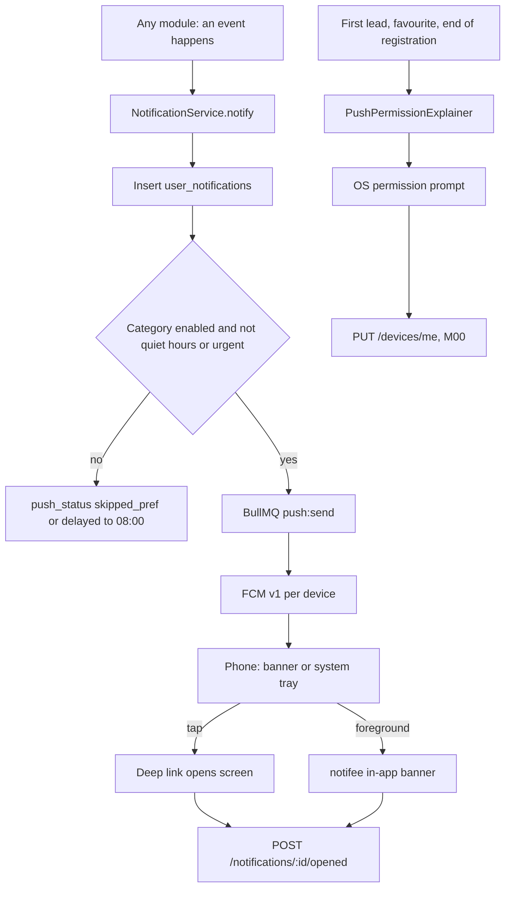
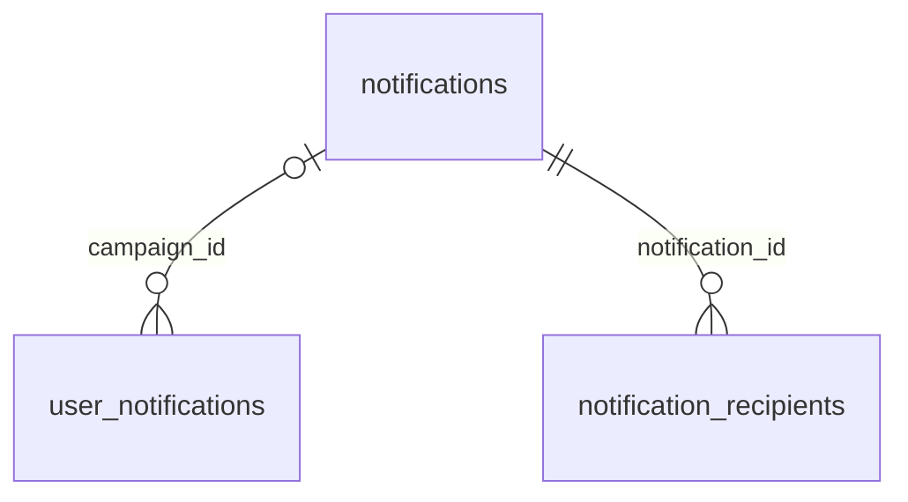

# Module 47 · Push Notifications

> **Phase 14 · Notifications** · **Used by:** Any user (infrastructure and reference used by every other module) · **Depends on:** M00 (delivery pipeline, device registration, NotificationService — this module documents its contract rather than rebuilding it), M20 (preference switches UI); Admin M46 (campaigns share this pipeline); every module listed in the event catalogue below · **New tables:** none · **Uses:** `user_devices`, `user_notifications`, `user_notification_preferences`, `notifications`, `notification_recipients` · **Build estimate:** 3–4 days

## 1. Module Purpose

This module doesn't send a single event of its own beyond open-tracking — it is the contract every other module's push follows. It restates the delivery pipeline M00 built (so it isn't re-explained 40 times), owns the one thing genuinely missing from M00's plumbing (`POST /notifications/:id/opened`, which closes the loop for both the in-app inbox and Admin M46's campaign analytics), defines the permission-request UX and Android/iOS channel mapping every screen with a push relies on, and — its main deliverable — gathers the **full event catalogue**: every push event any module defines, in one table, so a developer adding module 52 doesn't invent a fourth way to spell "your registration expired" or push a category the user turned off. Business rules that decide *when* an event fires stay in the module that owns the trigger (M37 decides when a lead is new, M44 decides when a subscription renews); this module only decides *how* any of them gets to a phone.

## 2. User Stories

- As a **developer** adding a new feature, I want one table of every existing push event so that I reuse a category and tone instead of inventing new copy.
- As a **parent**, I want to be asked for notification permission right after I send my first request, not on first launch, so the ask makes sense.
- As a **teacher**, I want lead notifications to sound different from a "your profile is verified" notification so I never miss a paying opportunity.
- As **product**, I want admin campaigns (Admin M46) to go through the exact same pipeline as a lead alert so delivery, quiet hours and counting are consistent everywhere.
- As a **user who tapped a notification while the app was closed**, I want it marked read and to land on the right screen without a second tap.

## 3. Business Rules & Logic

**BR-47.1 The pipeline (built in M00, restated as the contract every module's server code calls).** `NotificationService.notify(userId, { category, eventType, title, body, deepLink, data, dedupeKey, urgent })`: insert `user_notifications` (`ON CONFLICT (dedupe_key) DO NOTHING` — a retried job or a duplicate trigger never double-sends) → read `user_notification_preferences` for `category` (missing row = push on, email off) → disabled → `push_status = skipped_pref`, stop (the inbox row still exists — M48 shows it even with push off) → outside 08:00–21:30 IST and not `urgent` → delivery delayed to 08:00, not dropped → enqueue BullMQ `push:send` → worker loads the user's active `user_devices` (`revoked_at IS NULL`), sends one FCM v1 request per token (batched 500), sets `push_status = sent` if at least one token succeeded, `no_device` if there were none, and revokes any device whose token comes back `UNREGISTERED`/`INVALID_ARGUMENT`.

**BR-47.2 What every event needs.** A unique `eventType` (`<domain>.<verb>`, e.g. `payment.captured`), one of the 11 categories from conventions §16, a `dedupeKey` template unique per occurrence (e.g. `payment:<transactionId>:captured`, `lead:<leadId>:new`), and an `urgent` flag reserved for something the user must act on within minutes or that they caused seconds ago (a payment they just made, a demo starting in an hour, a renewal that just failed) — never for routine good news, which can wait for quiet hours to end.

**BR-47.3 Naming is inconsistent across a few early modules; this table is the point where it gets reconciled rather than silently duplicated.** `subscription.grace_started` (M10, an early build of the parent plan screen) and `subscription.renewal_failed` (M44, the full subscriptions module that supersedes it) describe the same underlying event — the client treats them as aliases and a later cleanup should retire the M10 name. Likewise `subscription.moved_to_free_access`/`.moved_to_trial` (M10) and `subscription.free_access` (M44) are the same event under two names. Several early modules (`lead_new`, `demo_requested`, `review_published`, …) used `snake_case` before this module fixed the `domain.verb` convention (BR-47.2) — they are not renamed retroactively (that would break stored `dedupeKey`s already in production), but every event added after this module ships uses the dotted form.

**BR-47.4 Admin campaigns share the pipeline, not the rules.** Admin M46 composes its own `title`/`body`/`deepLink`, resolves its audience, and inserts one `user_notifications` row per recipient with `campaign_id` set and `category` fixed to `announcements` — never a transactional category, so muting `announcements` never silences a lead or a payment. The same quiet-hours and `urgent` logic applies (`urgent` only for a Super Admin's campaign, Admin M46 FR-46.3); the 2-per-day cap (`notifications.daily_cap`) applies only to `announcements` campaigns, never to transactional events, which are uncapped by design.

**BR-47.5 Open tracking (`POST /notifications/:id/opened`).** Called once, the first time a `user_notifications` row is opened — cold start (`getInitialNotification`), background tap (`onNotificationOpenedApp`) or a foreground banner tap (BR-47.9) — for any row, transactional or a copied campaign. In one transaction: set `read_at = now()` if still null (this is the *tap* path; M48 additionally lets a user mark an item read from the inbox list without opening it, which is a separate, already-existing write this module doesn't duplicate); when `campaign_id IS NOT NULL`, also set `notification_recipients.status = 'opened', opened_at = now()` for `(campaign_id, sub)` and increment `notifications.opened_count` (Admin M46's funnel). Idempotent: opening an already-opened notification again is a no-op `200`.

**BR-47.6 Permission timing.** Never asked on first launch. One `PushPermissionExplainer` per meaningful moment, shown at most once every 14 days if dismissed or denied: parent/student — right after their first lead or first favourite, whichever happens first; teacher — at the end of registration ("Get notified the moment you're verified", M14/M20); institute — right after registration submission (M21). Android 13+ asks `POST_NOTIFICATIONS` directly after the explainer; iOS offers **provisional** authorisation (quiet delivery, no OS prompt) for the period before the first meaningful moment, so early transactional pushes (e.g. "Application submitted") still reach Notification Center silently without asking.

**BR-47.7 Android channels.** Created at first launch (M00 BR-0.1): `leads` (importance HIGH, sound + vibration — categories `leads`, `demos`), `payments` (DEFAULT — `payments`, `subscription`, `referral`), `account` (DEFAULT — `account`, `verification`, `complaints`), `reviews` (DEFAULT — `reviews`), `general` (LOW — `recommendations`, `announcements`). A category not in this list defaults to `general`. A user who mutes a channel in Android system settings still gets `push_status = sent` server-side — the OS silently drops it, which this module calls out for support scripts ("delivered but not received" is often a muted channel, not a bug).

**BR-47.8 iOS categories and threading.** One `UNNotificationCategory` per Android-channel group (same five, for consistent grouping in iOS Settings); `thread-id` = the deep link's entity id, so repeated pushes about one lead/demo/payment stack instead of scattering; `interruption-level` = `time-sensitive` when `urgent`, `active` otherwise (never `passive` — quiet hours already gate timing server-side, so nothing needs to be silently deprioritised on-device).

**BR-47.9 Foreground display.** `@notifee/react-native` renders an in-app banner for any FCM message that arrives while the app is foregrounded (`onMessage`), styled by category (icon + accent colour matching its channel group), auto-dismissing after 5 s, tappable to the same deep link a real notification tap would use — a tap here also calls `POST /notifications/:id/opened`.

**BR-47.10 Multiple devices.** A user signed in on two phones (M00 BR-0.6) receives the push on every active `user_devices` row; opening it on either marks the row read for both (M48 re-fetches the unread count on foreground, so the badge clears everywhere within one app-open).

## 4. Screen List

| Screen | Route name | Purpose |
| --- | --- | --- |
| Push permission explainer | `PushPermissionExplainer` (bottom sheet) | Shown once per meaningful moment, before the OS permission prompt |

## 5. Screen Flow & Navigation


A denied permission still lets pushes reach the app while foregrounded via provisional authorisation (iOS, BR-47.6) or the in-app banner (BR-47.9); it only stops background/killed-state delivery.

## 6. Screen Wireframe Description

**PushPermissionExplainer** — bottom sheet, illustration of a bell, heading and body vary by moment: parent/student after a lead — "Don't miss a reply", "Get notified the moment a teacher responds to your request."; teacher at registration end — "Know the second you're verified", "We'll tell you as soon as your documents are approved."; institute after submission — "Stay on top of enquiries", "Get notified when a parent reaches out."; second attempt (a later meaningful moment while still denied) — "Turn on notifications", "You'd have gotten a notification just now. Enable them in Settings." with a button **Open settings** instead of a repeat OS prompt (iOS/Android don't let an app re-trigger the system dialog after a denial). Primary state buttons: **Turn on notifications** and "Not now".

## 7. UI Components & Component Tree

```
PushPermissionExplainer (BottomSheet)
├─ BellIllustration
├─ Heading · Body (per moment)
└─ StickyActionBar → Button "Turn on notifications" | "Open settings" · link "Not now"
```
- `usePushPermission()` — tracks `pushPromptShownAt` (Zustand + MMKV), decides whether a moment qualifies (BR-47.6), requests the OS permission or opens system settings, and calls M00's `PUT /devices/me` with the resulting `pushPermission` state.
- `useNotificationOpened()` — mutation wrapping `POST /notifications/:id/opened`, called from `deeplinks.open()` (cold start and background taps) and from the notifee foreground banner's `onPress`.

## 8. Validation Rules

| Field | Rule | Message shown |
| --- | --- | --- |
| notificationId (path) | uuid v4, owned by the caller | (silent no-op; never shown — a stale/foreign id just does nothing) |

## 9. API Endpoints

| Method | Path | Auth | Description |
| --- | --- | --- | --- |
| POST | /notifications/:id/opened | Any user (owner) | Mark a notification opened; for a campaign, also updates its recipient row and `opened_count` |

Device registration (`PUT`/`DELETE /devices/me`) is owned by M00; push preference switches (`GET`/`PUT /notification-preferences`) are owned by M20; the in-app inbox (`GET /notifications`, mark read/delete) is owned by M48. This module calls all three out so a developer doesn't look for them here by mistake.

## 10. Request Payloads

```json
// POST /notifications/a1b2c3d4-5e6f-4a7b-8c9d-0e1f2a3b4c5d/opened
```

## 11. Response Payloads

```json
// 200 POST /notifications/:id/opened
{ "data": { "id": "a1b2c3d4-…", "readAt": "2026-09-26T10:31:02Z", "campaignUpdated": false } }
```

## 12. PostgreSQL Tables & Columns


**Existing tables this module reads or writes** (full definitions in the owning module)

| Table | Owner | Purpose |
| --- | --- | --- |
| `user_devices` | App M00 | Every app install a user has signed in on, with its FCM token. One row per (user, install). |
| `user_notifications` | App M00 | The in-app notification inbox for every user: transactional events and copies of admin campaigns. |
| `user_notification_preferences` | App M00 | Per-category push/email switches. Missing row = defaults (push on, email off). |
| `notifications` | Admin M46 | Push / in-app notification campaigns created by admins (transactional pushes are sent by services and not stored here). |
| `notification_recipients` | Admin M46 | Per-user delivery record for a campaign. Partition by month at scale. |

- `user_notifications`: this module writes only `read_at` on the open-tap path (BR-47.5); every other write (insert, `push_status`) belongs to M00's `NotificationService`, and list/mark-all-read/delete belong to M48.
- `notification_recipients`, `notifications`: this module updates `status`/`opened_at` and increments `opened_count` for campaign copies only, on the same open-tap call; all other columns are Admin M46's.
- `user_devices`: read only, by the M00-owned worker, to find active tokens — nothing here writes to it.
- `user_notification_preferences`: read only, by the pipeline (BR-47.1); the switches themselves are M20's.

## 13. Relationships


**Entity relationship diagram** (tables this module uses; `admins` omitted)



## 14. State Management

- `usePushFlags` (Zustand + MMKV): `{ pushPromptShownAt, pushPromptDismissCount, provisionalRequestedAt }`.
- No server-state query keys of its own beyond invalidating M48's `notificationKeys.unreadCount` after `useNotificationOpened()` succeeds.

## 15. Offline Handling

- `POST /notifications/:id/opened` is a **queue-offline** write (conventions §8 class 1 — idempotent, keyed by notification id, explicitly listed there as "notification read"): a tap while offline is stored and replayed FIFO on reconnect: the read state is visually applied immediately in the UI regardless.
- The permission explainer and OS prompts work fully offline (no network call until the resulting `PUT /devices/me`, which is itself queued per M00 BR-0.5, latest-wins).

## 16. Push Notification Requirements

The full catalogue — every push-sending event defined anywhere in this spec pack, so any two modules share categories, tone and urgency consistently. Full title/body copy and firing conditions live in the "Defined in" module; this table is the index.

| Event | Category | Recipient | Urgent | Defined in |
| --- | --- | --- | --- | --- |
| Password changed | account | Self | yes | M04 |
| Signed out everywhere (token reuse) | account | Self | yes | M04 |
| New device signed in | account | Self | no | M04 |
| `student.parental_consent_confirmed` | account | Student | no | M11 |
| `student.parental_consent_declined` | account | Student | yes | M11 |
| Invited staff joined | account | Inviter, primary manager | no | M21, M24 |
| Your role changed | account | Affected staff member | no | M24 |
| Your access was removed | account | Affected staff member (in-app only) | no | M24 |
| Weekly performance summary | account | Institute managers | no | M23 |
| Badge revoked / listing suspended | account | All institute staff | yes | M22 |
| Phone changed | account | Self | no | M51 |
| Email changed | account | Self | no | M51 |
| Password set/changed (from Settings) | account | Self | no | M51 |
| Google account linked/unlinked | account | Self | no | M51 |
| Registration submitted | verification | Teacher | no | M15 |
| Document approved | verification | Teacher | no | M16 |
| Re-upload requested | verification | Teacher | no | M16 |
| Application approved | verification | Teacher | yes | M16 |
| Application rejected | verification | Teacher | no | M16 |
| Draft not submitted reminder (24 h/72 h/7 d) | verification | Primary manager | no | M21 |
| Application submitted/resubmitted | verification | All institute managers (in-app only) | no | M22 |
| Documents requested | verification | All institute managers | no | M22 |
| Evaluation visit scheduled/rescheduled | verification | All institute managers | no | M22 |
| Evaluation visit tomorrow | verification | All institute managers | no | M22 |
| Institute approved | verification | All institute staff | yes | M22 |
| Institute rejected | verification | All institute managers | no | M22 |
| Docs-requested reminder (48 h/5 d) | verification | All institute managers | no | M22 |
| `lead_new` | leads | Teacher | no (`leads` channel is high-importance) | M37 |
| `lead_unviewed_reminder` | leads | Teacher | no | M37 |
| `lead_message` | leads | Other side of the conversation | no | M37 |
| `lead_contact_unlocked` | leads | Teacher | no | M37 |
| `lead_declined` | leads | Requester | no | M37 |
| `lead_converted` | leads | Teacher | no | M37 |
| `institute_enquiry_new` | leads | All active institute staff | no | M39 |
| `institute_enquiry_assigned` | leads | Assigned staff member | no | M39 |
| `institute_enquiry_unviewed_reminder` | leads | All active institute staff | no | M39 |
| Response rate below 50% | leads | Institute managers | no | M23 |
| `demo_requested` | demos | Teacher / institute staff | no | M38 |
| `demo_confirmed` | demos | Requester | no | M38 |
| `demo_reschedule_proposed` | demos | Other side | no | M38 |
| `demo_reschedule_accepted` | demos | Proposer | no | M38 |
| `demo_reminder` (1 hour before) | demos | Both sides | yes | M38 |
| `demo_cancelled` | demos | Other side | no | M38 |
| `demo_expired` | demos | Requester | no | M38 |
| `demo_no_show` | demos | Reported side | no | M38 |
| `demo_outcome_prompt` | demos | Both sides | no | M38 |
| `review_published` / `review_rejected` | reviews | Author | no | M34 |
| `review_prompt` (teacher) | reviews | Learner | no | M34 |
| `institute_review_published` / `_rejected` | reviews | Author | no | M35 |
| `institute_review_new` | reviews | All active institute staff | no | M35 |
| `institute_reply_approved` / `_rejected` | reviews | Reply author | no | M35 |
| `review_prompt` (institute) | reviews | Learner | no | M35 |
| `teacher_review_new` / `_edited` | reviews | Teacher | no | M36 |
| `teacher_reply_approved` / `_rejected` | reviews | Teacher | no | M36 |
| `payment.captured` | payments | Payer | yes | M43 |
| `payment.failed` | payments | Payer | yes | M43 |
| `payment.late_captured` | payments | Payer | no | M43 |
| `payment.refund_processed` | payments | Payer | no | M45 |
| `payment.refund_denied` | payments | Payer | no | M45 |
| `payment.refund_failed` | payments | Payer | no | M45 |
| `subscription.trial_ending` | subscription | Parent/student in trial | no | M10, superseded by M44 |
| `subscription.renewal_reminder` | subscription | Live-plan holder | no | M10, M44 |
| `subscription.renewal_failed` (alias `grace_started`, M10) | subscription | Live-plan holder | yes | M44 |
| `subscription.renewed` | subscription | AutoPay holder | no | M44 |
| `subscription.expired` | subscription | Expired-plan holder | no | M10, M44 |
| `subscription.free_access` (alias `moved_to_free_access`, M10) | subscription | Affected users | no | M44 |
| `subscription.autopay_on` / `_off` / `_reauth` | subscription | Parent/student | no | M44 |
| `subscription.registration_expiring` / `_expired` | subscription | Teacher / institute managers | no | M44 |
| `subscription.boost_expiring` / `_expired` | subscription | Teacher | no | M44 |
| `subscription.admin_changed` | subscription | Affected user | no | M44 |
| `referral.qualified` | referral | Referrer | no | M46 |
| `referral.rewarded` | referral | Referrer | no | M46 |
| `referral.referee_bonus` | referral | Referee | no | M46 |
| `referral.reversed` | referral | Whoever held the credit | no | M46 |
| Daily saved-search alert | recommendations | Saved-search owner | no | M29 |
| `favorite_teacher_verified` | recommendations | User who favourited | no | M40 |
| `favorite_teacher_fees_changed` | recommendations | User who favourited | no | M40 |
| `favorite_teacher_demos_open` | recommendations | User who favourited | no | M40 |
| Report acknowledged | complaints | Reporter | no | M49 |
| Information requested | complaints | Reporter or reported party | no | M50 |
| Case resolved/dismissed | complaints | Reporter only | no | M50 |
| Admin campaign (any copy, `campaign_id` set) | announcements | Resolved audience | Super Admin campaigns only | Admin M46 |

Categories not yet exercised by a shipped module (none at this pack's current state) will be added to this same table as those modules are written — the category set itself is fixed (conventions §16) so no new category is invented per feature.

## 17. Security Rules

- `POST /notifications/:id/opened` is ownership-scoped (`user_notifications.user_id = sub`); a foreign id is a silent no-op, never an error that would let a caller probe for other users' notification ids.
- No push payload (FCM `data` or `notification`) ever carries a phone number, full name beyond a first-name template variable, or a document/document number — matching conventions §13's no-PII-in-logs rule extended to push payloads, since FCM payloads pass through Google's infrastructure.
- Deep links inside push `data` are validated against the same route registry as any other deep link (M00 BR-0.11) before being opened — a malformed or unknown `deepLink` in a push opens Home with the "not available" toast rather than crashing.
- Quiet hours and category preferences are enforced server-side only; there is no client-side override (a user cannot force an `urgent: false` event through at 2 AM by any client setting).

## 18. Error Handling

| Scenario | Code | HTTP | App behaviour |
| --- | --- | --- | --- |
| Notification id belongs to another user or doesn't exist | — | 200 | Silent no-op (BR-47.5's ownership scoping; never surfaced to the user) |
| Offline when a tap fires the call | — (queued) | — | Read state applied locally immediately; call replays on reconnect |
| OS permission previously denied, user taps "Turn on notifications" | — | — | Client opens native app settings instead of re-prompting (OS limitation, not an API error) |
| Malformed/unknown deep link in a push payload | — | — | Opens Home + toast "That link isn't available." (M00 BR-0.11) |

## 19. Testing Scenarios

- T47.1 Happy path (Maestro `push_permission_and_tap`): parent sends their first lead → `PushPermissionExplainer` appears once → allow → `PUT /devices/me` shows `pushPermission: granted` → a `lead_declined` push later arrives, app backgrounded → tap → app opens on `LeadDetail` → `POST /notifications/:id/opened` fires once.
- T47.2 Deny permission → explainer does not reappear until a second meaningful moment ≥ 14 days later or a foregrounded push is missed; second explainer shows **Open settings**, not a repeat OS prompt.
- T47.3 Two devices signed in → a push is delivered to both; tapping on device A marks it read; device B's badge clears on next foreground.
- T47.4 Quiet hours (23:00 IST), non-urgent event → `push_status` stays pending until 08:00, then delivers; an `urgent` event at the same time delivers immediately.
- T47.5 Category `payments` disabled in preferences → no push for `payment.captured`, but the transaction still appears in `GET /notifications` (M48) with `push_status = skipped_pref`.
- T47.6 Admin M46 sends a campaign to 20,000 users → each recipient's `user_notifications` row has `category = announcements`, `campaign_id` set; a user who disabled `announcements` gets none, but a `lead_new` push to the same user still arrives.
- T47.7 Tapping a campaign notification → `POST /notifications/:id/opened` sets both `user_notifications.read_at` and `notification_recipients.status = opened`; `notifications.opened_count` increments by exactly 1 even if tapped twice (idempotent).
- T47.8 App killed, notification tapped (cold start) → `getInitialNotification` path opens the deep link after the M01 launch gates, and still calls `opened`.
- T47.9 Foreground banner (notifee) for an incoming `demo_reminder` → auto-dismisses after 5 s if untapped; tapping it opens `DemoDetail` and calls `opened`.
- T47.10 Offline tap on a notification → read state shown instantly; `POST /notifications/:id/opened` queued and sent once back online, deduplicated if the queue somehow retries.
- T47.11 A revoked device (`UNREGISTERED` from FCM) receives no more pushes; the user's other active device still gets them.
- T47.12 `subscription.grace_started` (M10) and `subscription.renewal_failed` (M44) firing for the same subscription lapse are treated as the same event client-side (single banner, not two).

## 20. Audit Log Events

No events of its own. `POST /notifications/:id/opened` is a read receipt, not an audit-worthy action (conventions §11 — reads and low-stakes interactions aren't audit-logged); the events that trigger a push are audited, if at all, by the module that owns the trigger.

## 21. Future Scalability Notes

- Rich push (images, action buttons — "Reply" inline for `lead_message`) once FCM's data payload size and Notifee's action-button support are worth the added complexity.
- Per-user send-time optimisation (send within quiet hours' end at the time historically most opened) instead of a fixed 08:00 for delayed non-urgent pushes.
- Consolidate near-duplicate events into one send when several fire within a short window for the same user (e.g. two leads within a minute), to reduce notification fatigue.
- A dedicated events service (outside the shared Express/BullMQ stack) once push volume passes a few million sends/day.
- SMS/WhatsApp fallback for `urgent` categories when a user has no active device and push has failed twice running.
- Retire the pre-convention event names (BR-47.3) in a single migration once all clients on old dedupe-key formats have aged out (30-day `user_notifications` lookback is enough to confirm).
