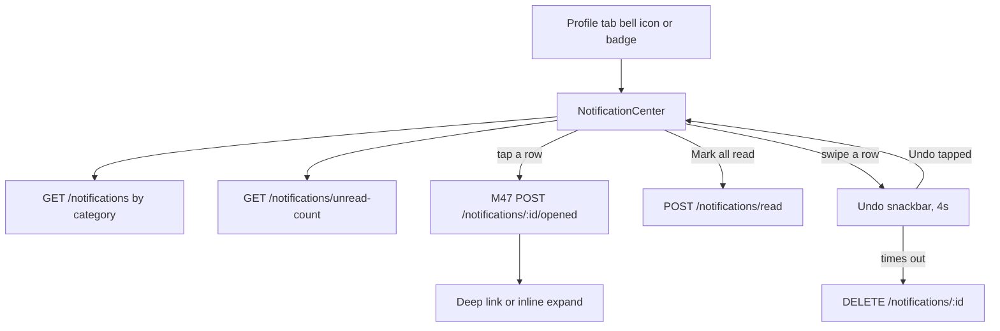

# Module 48 · Notification Center

> **Phase 14 · Notifications** · **Used by:** Any user · **Depends on:** M00 (owns the `user_notifications` table and the insert pipeline), M47 (event catalogue and tap-to-open tracking); Admin M46 (campaign copies land in the same inbox) · **New tables:** none · **Uses:** `user_notifications` · **Build estimate:** 2 days

## 1. Module Purpose

The inbox: every notification a user has ever received — a lead alert, a verification update, a payment receipt, or a copied admin campaign — in one scrollable, filterable list with an unread badge that also drives the Profile tab's badge dot. This module generates nothing; M00 inserts the rows and M47 defines what each event means and how tapping a push is tracked. Here, a user reads, filters by category, marks things read, and swipes away what they don't need — ordinary inbox housekeeping, nothing more.

## 2. User Stories

- As a **parent**, I want to see every notification I've had, even ones I dismissed from the system tray, so nothing important gets lost.
- As a **teacher**, I want to filter to just Leads so I can scan for anything I missed while my phone was on silent.
- As **anyone**, I want the unread badge on my Profile tab to clear once I've actually looked, not before.
- As a **user with 200 old notifications**, I want the list to load fast and scroll smoothly without jank.
- As **anyone**, I want to swipe away a reminder I don't need without having to open it first.

## 3. Business Rules & Logic

**BR-48.1 Source and scope.** `GET /notifications` reads `user_notifications` where `user_id = sub`, `deleted_at IS NULL`, and `(expires_at IS NULL OR expires_at > now())` — a handful of purely in-app confirmations (e.g. `subscription.cancelled`, "Refund requested") are written with a short `expires_at` and quietly drop out of the inbox after a few days without needing a swipe; everything else stays until deleted or the 12-month retention job runs (BR-48.9).

**BR-48.2 Category tabs.** "All" plus only the categories that have at least one row for this user in the last 90 days (a parent who has never filed a complaint never sees a "Complaints" tab), in the fixed order from conventions §16 (`account, verification, leads, demos, reviews, payments, subscription, referral, complaints, recommendations, announcements`) with "All" pinned first. Each tab shows its own unread count as a small badge; switching tabs never marks anything read by itself.

**BR-48.3 List (`GET /notifications`).** Cursor-paginated, newest first, 20 per page, optional `?category=`. Each row: `title`, `body`, `category`, `deepLink`, `imageUrl` (campaigns only), `createdAt`, `read` (`read_at IS NOT NULL`), `campaignId` (nullable — present only for a copied admin campaign, Admin M46).

**BR-48.4 Unread count (`GET /notifications/unread-count`).** Reads the Redis cache `unread:<userId>` that M00's `NotificationService` maintains (BR-0.7 — incremented on insert, decremented on read, recomputed from a `COUNT` query on a cache miss). Returns the total (drives the Profile tab badge and the app icon badge) and a per-category breakdown (drives BR-48.2's tab badges) in one call so the screen never needs two round-trips.

**BR-48.5 Mark read (`POST /notifications/read`).** Body is either `{ ids: [...] }` (specific rows — used when a row is opened without navigating, see BR-48.8) or `{ all: true, category? }` (every unread row, optionally scoped to one tab — the "Mark all read" action). Sets `read_at = now()` only where still null; already-read rows are silently skipped, never an error, and the call is safe to repeat. This path **never** touches `notification_recipients` — see BR-48.7.

**BR-48.6 Swipe delete (`DELETE /notifications/:id`).** Soft delete (`deleted_at = now()`), owner-scoped. The row list-item removes itself immediately and shows a **snackbar** "Notification deleted · Undo" for 4 seconds; the actual `DELETE` call fires only once the snackbar times out without an Undo tap, so an accidental swipe never reaches the server at all. There is no server-side undo after that window — deleting is final and the row does not come back.

**BR-48.7 Read-from-list is not the same signal as opened-from-tap.** Marking read here (BR-48.5) sets only `user_notifications.read_at`. It never sets `notification_recipients.status`/`opened_at` or increments `notifications.opened_count` for a copied campaign — that is exclusively M47's `POST /notifications/:id/opened` (BR-47.5), fired only when the user actually taps into the notification (from a push, from the foreground banner, or by tapping the row here per BR-48.8). This keeps Admin M46's "opened" funnel honest: scrolling past a campaign in the inbox without engaging it must not count as an open.

**BR-48.8 Row tap.** Tapping a row (not swiping) does three things in order: calls `POST /notifications/:id/opened` (M47 BR-47.5 — sets `read_at` if still null, and updates the campaign counters when applicable), then routes through `deeplinks.open(deepLink)` (M00 BR-0.11) if one exists. A row with no `deepLink` (a few in-app-only confirmations) instead expands in place (accordion) to show the full `body` text — there's nowhere else to send the user, but the message may be longer than the two-line preview.

**BR-48.9 Retention.** Rows older than 12 months are hard-deleted by a nightly job (no user action, no notice) — matching M00's scalability note on partitioning `user_notifications`. This is invisible to the user; nothing in the product surfaces "notifications older than a year are removed."

## 4. Screen List

| Screen | Route name | Purpose |
| --- | --- | --- |
| Notification center | `NotificationCenter` | Category tabs, the full inbox list, mark-all-read, swipe to delete |

## 5. Screen Flow & Navigation


Back on `NotificationCenter` returns to Profile (or wherever the bell icon lives in the current tab). A push tap that cold-starts the app does not pass through this screen — it opens the deep link directly (M47/M00) and this screen simply reflects the resulting read state next time it's opened.

## 6. Screen Wireframe Description

**NotificationCenter** — header "Notifications" with a text button **Mark all read** (top right, disabled/hidden when the current tab's unread count is 0). Horizontally scrollable category chips: "All 12", "Leads 4", "Payments 2", … (count shown only when > 0, hidden entirely at 0). Rows (`FlashList`, swipeable): category icon (colour matches its Android-channel group, M47 BR-47.7), title (bold if unread, with a small unread dot at the leading edge), body preview (2 lines, `numberOfLines={2}`), relative time ("2h ago", "Yesterday", "3 Sep"), campaign rows additionally show a small thumbnail from `imageUrl`. Swipe left reveals a red **Delete** action; releasing triggers BR-48.6. Pull-to-refresh. Infinite scroll with `ListFooterLoader`. Empty (a given tab has nothing): illustration, "No {category} notifications", body "You're all caught up."; the "All" tab's empty state instead reads "No notifications yet", "We'll let you know when something needs your attention." Loading: 8 skeleton rows. Error: `ErrorState` + Retry.

## 7. UI Components & Component Tree

```
NotificationCenterScreen
├─ CategoryTabs (chip row, counts)
├─ MarkAllReadButton
├─ HistoryList (FlashList, swipeable) → NotificationRow
│  └─ SwipeToDelete → UndoSnackbar
└─ EmptyState | ErrorState | Skeleton × 8
```
- `NotificationRow({ notification, onPress, onSwipeDelete })`, `CategoryTabs({ categories, active, onChange })`.
- Hooks: `useNotificationsInfinite(category?)`, `useUnreadCountQuery()` (`staleTime` 15 s, refetches on app foreground — feeds the Profile tab badge globally, not just this screen), `useMarkReadMutation()`, `useMarkAllReadMutation(category?)`, `useDeleteNotificationMutation()` (fired only after the undo window, per BR-48.6).

## 8. Validation Rules

| Field | Rule | Message shown |
| --- | --- | --- |
| ids | array of 1–100 uuids, all owned by the caller | — (silently ignores any id that isn't the caller's) |
| all | boolean | — |
| category | one of the 11 categories from conventions §16 | — |
| cursor / limit | opaque string; limit 1–50 (default 20) | — |

## 9. API Endpoints

| Method | Path | Auth | Description |
| --- | --- | --- | --- |
| GET | /notifications | Any user | Inbox, newest first (cursor), `?category=`, with per-category unread counts |
| GET | /notifications/unread-count | Any user | Total and per-category unread counts (badge source) |
| POST | /notifications/read | Any user | Mark specific ids, or all (optionally one category), read |
| DELETE | /notifications/:id | Any user (owner) | Soft-delete one notification (swipe) |

Reused: M47 `POST /notifications/:id/opened` is what a row tap calls before following its deep link (BR-48.8); this module's own endpoints never touch `notification_recipients`.

## 10. Request Payloads

```json
// GET /notifications?category=leads&limit=20

// GET /notifications/unread-count

// POST /notifications/read
{ "all": true, "category": "leads" }

// POST /notifications/read
{ "ids": ["a1b2c3d4-5e6f-4a7b-8c9d-0e1f2a3b4c5d"] }

// DELETE /notifications/9c4e1f2a-3b5d-4e6f-8a7b-1c2d3e4f5a6b
```

## 11. Response Payloads

```json
// 200 GET /notifications?category=leads
{ "data": [
  { "id": "a1b2c3d4-…", "category": "leads", "title": "New request from Aarav's parent", "body": "Class 8 · Mathematics · Home tuition. Reply within 24 h.",
    "deepLink": "gc://leads/7c9e6679-…", "imageUrl": null, "campaignId": null, "read": false, "createdAt": "2026-09-26T09:02:00Z" },
  { "id": "9c4e1f2a-…", "category": "leads", "title": "Priya S. is waiting", "body": "Reply to keep your response rate high.",
    "deepLink": "gc://leads/…", "imageUrl": null, "campaignId": null, "read": true, "createdAt": "2026-09-24T11:00:00Z" } ],
  "meta": { "nextCursor": null } }

// 200 GET /notifications/unread-count
{ "data": { "total": 12, "byCategory": { "leads": 4, "payments": 2, "subscription": 1, "reviews": 3, "verification": 2 } } }

// 200 POST /notifications/read
{ "data": { "updated": 4 } }

// 200 DELETE /notifications/:id
{ "data": { "id": "9c4e1f2a-…", "deletedAt": "2026-09-26T10:40:00Z" } }
```

## 12. PostgreSQL Tables & Columns


**Existing tables this module reads or writes** (full definitions in the owning module)

| Table | Owner | Purpose |
| --- | --- | --- |
| `user_notifications` | App M00 | The in-app notification inbox for every user: transactional events and copies of admin campaigns. |

`user_notifications`: this module reads for the list, unread count and tab set, and writes `read_at` (BR-48.5) and `deleted_at` (BR-48.6) — the only two columns it ever writes. Every other column (`category`, `event_type`, `title`, `body`, `deep_link`, `image_url`, `data`, `campaign_id`, `dedupe_key`, `push_status`, `expires_at`) is written once, at insert, by M00's `NotificationService`; this module never updates them.

## 13. Relationships

No database relationships (client-side module).

## 14. State Management

- Query keys (`notificationKeys`): `notificationKeys.list(category, cursor)` (infinite, persisted first page per category), `notificationKeys.unreadCount()` (persisted, `staleTime` 15 s, refetched on app foreground and read anywhere the badge is shown, e.g. the Profile tab icon).
- `useMarkReadMutation`/`useMarkAllReadMutation`/`useDeleteNotificationMutation` are **optimistic** (conventions §7 explicitly allows this for "mark read" and similarly reversible, idempotent actions): the row updates/disappears instantly; on a server error the row and unread count roll back with a toast "Couldn't update. Try again."
- Every mutation invalidates `notificationKeys.unreadCount()`; delete and mark-read also patch the relevant `notificationKeys.list` page directly instead of a full refetch (avoids a visible reshuffle).

## 15. Offline Handling

- The list and unread count render from the persisted cache offline ("Updated 2 h ago").
- Mark read and delete are **queue-offline** (conventions §8 class 1 — both are idempotent and keyed by notification id; "notification read" is explicitly named there as an example): the optimistic UI applies immediately regardless of connectivity, and the call replays on reconnect.
- Row tap's deep-link navigation works offline for any screen that itself renders from cache; `POST /notifications/:id/opened` (M47) queues the same way.

## 16. Push Notification Requirements

None from this module — it is the pure consumer of every event in M47's catalogue and sends nothing of its own.

## 17. Security Rules

- Every operation is owner-scoped (`user_id = sub`); `ids` in a mark-read call are filtered server-side to the caller's own rows (an id belonging to someone else is silently dropped, not an error, so ids can't be probed).
- Campaign `imageUrl`s are public CDN URLs (Admin M46, `gc-public`); nothing in this screen exposes another user's data — every row was already scoped to `sub` at insert time by `NotificationService`.
- No new PII exposure: a row's `title`/`body` is exactly what the originating module already decided was safe to put in a push (M47 BR-47.2's payload rule applies equally here, since the inbox row and the push share the same text).

## 18. Error Handling

| Scenario | Code | HTTP | App behaviour |
| --- | --- | --- | --- |
| id in `ids`/`DELETE :id` not owned by caller or already gone | — | 200 | Silently ignored / no-op (never reveals whether the id ever existed) |
| `ids` array over 100 | `VALIDATION_FAILED` | 422 | Client never sends more than 100; defensive only |
| Unknown category filter | `VALIDATION_FAILED` | 422 | Client-side enum, can't happen from the UI |
| Offline mark-read/delete | — (queued) | — | Optimistic UI applies now; call replays on reconnect |

## 19. Testing Scenarios

- T48.1 Happy path (Maestro `notification_center_read_and_filter`): teacher opens Notification Center → "All" shows mixed categories → switches to "Leads" tab → taps an unread row → row marked read, deep link opens `LeadDetail`, unread badge decrements by 1.
- T48.2 "Mark all read" on the "Payments" tab → only payments-category rows update; other tabs' unread counts unchanged.
- T48.3 Swipe a row → it disappears with an Undo snackbar; tapping Undo within 4 s restores it and no `DELETE` call is made; letting it time out calls `DELETE` and the row stays gone on next fetch.
- T48.4 A campaign notification is tapped → `notification_recipients.status` becomes `opened` and `notifications.opened_count` increments by 1 (via M47); scrolling past ten other campaign rows without tapping them changes neither.
- T48.5 A row with no `deepLink` (an in-app-only confirmation) is tapped → expands in place to show full body; no navigation occurs.
- T48.6 Category tab set only shows categories with activity in the last 90 days; a parent who has never had a complaint never sees a "Complaints" tab.
- T48.7 Two devices signed in: marking read on device A updates the unread badge on device B within one foreground refresh.
- T48.8 Offline: list renders from cache; swiping a row updates the UI immediately and queues the delete; reconnect sends it once.
- T48.9 200 notifications on the account → pagination returns 20 per page with a stable `nextCursor`, no duplicates or gaps across pages while new ones arrive concurrently.
- T48.10 A notification with `expires_at` in the past (e.g. an old "Refund requested" confirmation) is absent from `GET /notifications` even though `deleted_at` is still null.
- T48.11 Mark-read call for an id belonging to another user → 200 no-op, no row changed, no error surfaced.
- T48.12 Nightly retention job removes a 13-month-old row → it was already invisible to the user well before deletion (no user-facing change).

## 20. Audit Log Events

No events. Reading, marking read and deleting one's own inbox items are routine, low-stakes actions on the user's own data (conventions §11 — reads and preference-level interactions aren't audit-logged); the underlying events that populate the inbox are audited, if at all, by the module that generated them.

## 21. Future Scalability Notes

- Inline notification grouping ("3 new leads" collapsing several `lead_new` rows from the same day) once volume makes a flat list noisy.
- A quick "Mute this category" action right from a row's swipe menu, deep-linking into M20's preference switches instead of a separate settings trip.
- Search within notifications once the list is long enough to need it (title/body full-text).
- Rich campaign layouts (carousel, video) for `announcements` rows, matching whatever Admin M46 adds to campaign composition.
- Move `user_notifications` to a partitioned table (by month) once the 12-month retention job is deleting a meaningful fraction of total rows nightly (M00's existing scalability note).
