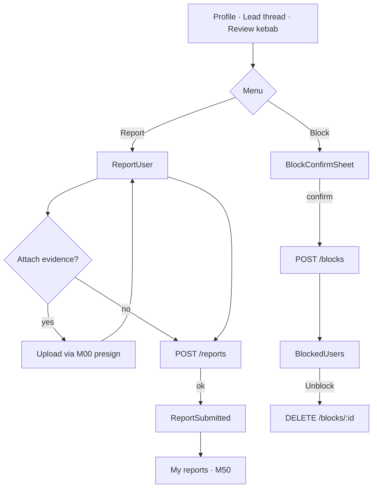
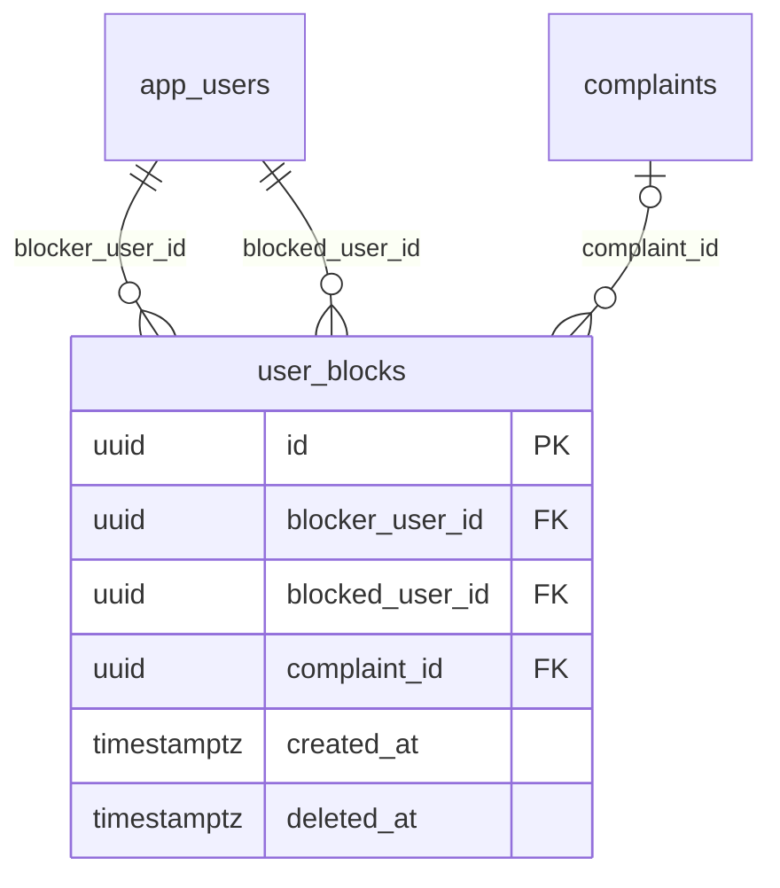

# Module 49 · Report User

> **Phase 15 · Complaints** · **Used by:** Parent, Student, Teacher, Institute staff (any signed-in role — "Any user") · **Depends on:** M00 (uploads, notifications), M37 (leads context, existing block-on-contact rule), M50 (view a filed report); Admin M43 (triage, SLA, enforcement), Admin M36 (trust score effect) · **New tables:** `user_blocks` · **Uses:** `complaints`, `complaint_actions`, `complaint_attachments`, `leads`, `teachers`, `institutes`, `files`, `app_users`, `user_notifications`, `audit_logs` · **Build estimate:** 4–5 days

## 1. Module Purpose

The safety entry point every profile, lead thread and review exposes. Parents and students can report a teacher or institute; teachers can report the parent or student on a lead; institute staff can report a parent or student who contacted them. A report creates a `complaints` case that Admin M43 triages and works, with an SLA and a full timeline. The module also owns blocking: either side of an interaction can block the other, which immediately stops contact, messages, calls, demos and reviews between the pair. The reporter's identity is never revealed to the person they reported, at any point in this app.

## 2. User Stories

- As a **parent**, I want to report a teacher who asked me to pay outside the app so that GuruConnect looks into it and I have a record.
- As a **teacher**, I want to report a parent who was abusive in chat so that they can't keep contacting me.
- As an **institute counsellor**, I want to report a parent who sent harassing messages to our enquiry inbox.
- As a **student on a slow connection**, I want the report form to keep my typed description if my upload fails so that I don't have to start over.
- As **any user**, I want to block someone without filing a report so that they simply can't reach me again.

## 3. Business Rules & Logic

**BR-49.1 Who can report whom.** `reporter_type` is derived from the caller's role (`parent`, `student`, `teacher`, `institute_staff`); `reported_type` is chosen on the form and constrained by role: parents/students → `teacher` or `institute`; teachers → `parent` or `student`; institute staff → `parent` or `student`. Reporting your own account, or a role your account cannot target, is rejected client-side and re-checked server-side (`VALIDATION_FAILED`).
**BR-49.2 Target resolution.** For `reported_type = teacher`/`institute` the form takes a `teacherId`/`instituteId` (from the profile, a lead or a review); for `parent`/`student` it takes the `reportedUserId`, which must be the counterparty on a `leadId` the caller supplies (`leads.requester_user_id` for a teacher/institute reporting, or the lead's teacher/institute side for a learner reporting) — this prevents reporting an arbitrary stranger. `leadId` is optional only when reporting a teacher/institute directly from their profile (no prior contact needed, since anyone can misrepresent a profile). Target not found, deleted or already `account_status = banned` → `NOT_FOUND`.
**BR-49.3 Intake.** `POST /reports` inserts one `complaints` row in a transaction: `reporter_user_id = sub`, `reporter_type`, `reported_type`, `reported_user_id` or `reported_institute_id` per BR-49.2's constraint (`ck_complaints_target`), `lead_id` if supplied, `complaint_type` (`fraud`, `misconduct`, `fake_information`, `harassment`, `other`), `description` (20–3,000 chars), `status = 'open'`. In the same transaction: one `complaint_actions` row (`action = 'created'`, `is_internal = true`, `admin_id = null`), and one `complaint_attachments` row per confirmed `fileId` (purpose `complaint_evidence`, `uploaded_by_type = 'app_user'`). `Idempotency-Key` on the create so a retried submit never files twice.
**BR-49.4 Triage on create (mirrors Admin M43 FR-43.2 exactly, computed by the app's server, not the client).** Severity: `harassment`, or a description match against `system_settings` key `complaints.safety_keywords`, or the reported party already has ≥ 2 complaints in the last 30 days → `critical`; `fraud` → `high`; `misconduct` → `medium`; `fake_information`/`other` → `low`. `sla_due_at` = `created_at` + 4 h (critical), 24 h (high), 72 h (medium/low). A `critical` case against a teacher freezes their trust score (Admin M36) until the case closes.
**BR-49.5 Evidence.** Up to 5 attachments per report, `image/jpeg`, `image/png`, `application/pdf`, ≤ 10 MB each, uploaded first via M00 presign with `purpose = complaint_evidence` (private bucket) and passed as confirmed `fileId`s. A user may not attach a file they don't own (`files.uploaded_by_id != sub` → `FORBIDDEN`).
**BR-49.6 Acknowledgement.** On success, `NotificationService.notify` inserts `user_notifications` for the reporter only (category `complaints`, not urgent) with the case number; no notification is sent to the reported party at intake — they learn of enforcement only if and when an admin warns or suspends them (Admin M43 FR-43.4), never that a report exists.
**BR-49.7 Reporter identity is never shown to the reported party.** Every response and screen the reported party can see (this module, M50, any warning/suspension notice) omits `reporter_user_id`, `reporter_type`'s display name and the description's identifying details are only ever shown to Admin. The reported party sees only "A user reported you" plus the substance of any warning.
**BR-49.8 Rate limit.** Max 5 reports created per rolling 24 h per reporter (`LIMIT_REACHED`, `details.reason = "max_reports_per_day"`); this is separate from the general 120 req/min limit.
**BR-49.9 Blocking (`user_blocks`, owned here).** `POST /blocks { blockedUserId, reason?, complaintId? }` — blocking a user with no active identical row (`blocker_user_id`, `blocked_user_id`, `deleted_at IS NULL`) is idempotent: a second call while one is active returns the existing row rather than erroring. `reason` (0–500 chars, optional) and `complaintId` (optional, must belong to `sub` as reporter or reported party) are stored for context. In the same transaction: any `leads` row between the pair with `status IN ('new','viewed','contacted')` is set to `closed`, `decline_reason = 'blocked'` (mirrors M37's block-closes-leads rule); the pair can no longer create leads, send lead messages, book demos, leave or reply to reviews, or see each other's contact details — every one of those modules checks `user_blocks` before acting (`BLOCKED`).
**BR-49.10 Report-and-block together.** The report form has an "Also block this user" switch (default on for `harassment`/`fraud`); when checked, `POST /reports` creates the block in the same transaction with `complaint_id` set to the new case, after the complaint insert succeeds.
**BR-49.11 Unblock.** `DELETE /blocks/:blockedUserId` sets `deleted_at = now()` on the caller's active block row against that user (`NOT_FOUND` if none active). Unblocking does not reopen closed leads or undo a linked complaint's outcome.
**BR-49.12 Listing blocks.** `GET /blocks` returns the caller's active blocks (`blocker_user_id = sub`, `deleted_at IS NULL`), newest first, with the blocked user's minimal display info (name, role, avatar) — the app never lists who has blocked the caller.

## 4. Screen List

| Screen | Route name | Purpose |
| --- | --- | --- |
| Report user | `ReportUser` | Reason, description, evidence, block switch |
| Report submitted | `ReportSubmitted` | Confirmation with case number, link to M50 |
| Blocked users | `BlockedUsers` | List of people the caller has blocked, with unblock |
| Block confirm | (bottom sheet) `BlockConfirmSheet` | Confirms a standalone block from a profile or chat |

## 5. Screen Flow & Navigation


Back from `ReportUser` while text is entered asks "Discard this report?" (draft is kept in the offline queue's draft store, not discarded silently). `ReportSubmitted` has no back — its only exits are "View my reports" and "Done" (Home).

## 6. Screen Wireframe Description

**ReportUser** — header "Report {name}" (or "Report Dr. Ananya Iyer" / "Report GuruShiksha Academy"). Section "What happened?" — reason chips: Fraud / Misconduct / Fake information / Harassment / Other. Text area "Tell us what happened" placeholder "Be specific — dates, amounts, what was said…", counter "20 char minimum · 640/3,000". "Add evidence (optional)" — up to 5 thumbnails, "+ Add photo or PDF" opens image/document picker. Switch row "Also block this user" with helper "They won't be able to contact you again" — on by default for Harassment/Fraud. Sticky button "Submit report" (disabled under 20 chars); small print "The person you report will never see who reported them."

**ReportSubmitted** — check illustration, heading "Report submitted", body "Case CS-4471 · We aim to respond within 24 hours for this type of report.", buttons "View my reports" (primary) and "Done" (secondary).

**BlockedUsers** — list rows: avatar, name, role label ("Teacher" / "Parent"), "Blocked 12 Sep 2026", trailing "Unblock" text button (opens confirm sheet "Unblock Rohan S.? They'll be able to contact you again."). Empty: "You haven't blocked anyone."

**BlockConfirmSheet** — heading "Block {name}?", body "They won't be able to message, call or send you leads. Any open enquiry between you will be closed.", optional short reason field, buttons "Block" (destructive) and "Cancel".

## 7. UI Components & Component Tree

```
ReportUserScreen
├─ ReasonChips
├─ DescriptionField (counter)
├─ EvidencePicker (thumbnails, max 5)
├─ BlockSwitch
└─ StickyActionBar "Submit report"
ReportSubmittedScreen
BlockedUsersScreen
├─ FlashList<BlockedUserRow>
└─ EmptyState
BlockConfirmSheet (BottomSheet)
```
- `ReportUserForm({ targetType, targetId, leadId?, onSubmitted })` — owns the Zustand-backed draft.
- `BlockedUserRow({ user, onUnblock })`.
- Hooks: `useSubmitReportMutation()`, `useBlockMutation()`, `useUnblockMutation()`, `useBlockedUsersQuery()`.

## 8. Validation Rules

| Field | Rule | Message shown |
| --- | --- | --- |
| reportedType | must match an allowed target for the caller's role | "You can't report this." |
| complaintType | one of fraud, misconduct, fake_information, harassment, other | "Choose a reason." |
| description | 20–3,000 chars, ≥ 5 words, not only emoji/repeated chars | "Add a few more details (20 characters minimum)." |
| fileIds | 0–5, each an active, owned, `complaint_evidence` upload | "Remove a file and try again." |
| leadId | required when reporting a parent/student; must involve both parties | "We couldn't find that conversation." |
| blockedUserId | not the caller; not already blocked (idempotent, no error) | — |
| block reason | 0–500 chars | "Keep it under 500 characters." |

## 9. API Endpoints

| Method | Path | Auth | Description |
| --- | --- | --- | --- |
| POST | /reports | Any user | File a safety report (Idempotency-Key) |
| POST | /blocks | Any user | Block a user (Idempotency-Key) |
| DELETE | /blocks/:blockedUserId | Any user | Unblock |
| GET | /blocks | Any user | List the caller's active blocks |

## 10. Request Payloads

```json
// POST /reports   (Idempotency-Key: 7c1e…)
{ "reportedType": "teacher", "teacherId": "8b6e4f10-…", "leadId": null, "complaintType": "fraud",
  "description": "Asked me to pay ₹5,000 advance on GPay outside the app before the first class, then stopped replying.",
  "fileIds": ["a1c2…", "a1c3…"], "alsoBlock": true }

// POST /blocks   (Idempotency-Key: 91fa…)
{ "blockedUserId": "d4e5f6a7-…", "reason": "Kept messaging after I said no.", "complaintId": null }
```

## 11. Response Payloads

```json
// 201 POST /reports
{ "data": { "id": "…", "caseNumber": "CS-4471", "status": "open", "severity": "high", "slaDueAt": "2026-09-27T10:15:00Z",
  "blocked": true } }

// 201 POST /blocks
{ "data": { "id": "…", "blockedUserId": "d4e5f6a7-…", "createdAt": "2026-09-26T10:15:00Z" } }

// 200 GET /blocks
{ "data": [ { "id": "…", "blockedUser": { "id": "d4e5f6a7-…", "displayName": "Rohan S.", "role": "parent" }, "createdAt": "2026-09-12T09:00:00Z" } ],
  "meta": { "nextCursor": null } }

// 422 max reports reached
{ "error": { "code": "LIMIT_REACHED", "message": "You've reached today's report limit. Please try again tomorrow.",
  "details": { "reason": "max_reports_per_day" }, "requestId": "…" } }
```

## 12. PostgreSQL Tables & Columns

**New tables owned by this module** (migration `sql/migrations/149_app_m49_report_user_blocks.sql`)

### `user_blocks`

Users one user has blocked. Blocked users can't contact, message or review the blocker.

| Column | Type | Null | Default | Constraints / References | Description |
| --- | --- | --- | --- | --- | --- |
| `id` | uuid | no | gen_random_uuid() | PK | Primary key |
| `blocker_user_id` | uuid | no | — | FK → `app_users.id` (on delete cascade) | Who blocked |
| `blocked_user_id` | uuid | no | — | FK → `app_users.id` (on delete cascade) | Who is blocked |
| `complaint_id` | uuid | yes | — | FK → `complaints.id` (on delete set null) | Report filed at the same time, if any |
| `created_at` | timestamptz | no | now() | — | Blocked |
| `deleted_at` | timestamptz | yes | — | — | Unblocked (soft delete) |

**Table constraints:** `CONSTRAINT ck_user_blocks_self CHECK (blocker_user_id <> blocked_user_id)`

<details><summary>DDL</summary>

```sql
CREATE TABLE user_blocks (
  id uuid PRIMARY KEY DEFAULT gen_random_uuid(), -- Primary key
  blocker_user_id uuid NOT NULL REFERENCES app_users(id) ON DELETE CASCADE, -- Who blocked
  blocked_user_id uuid NOT NULL REFERENCES app_users(id) ON DELETE CASCADE, -- Who is blocked
  complaint_id uuid REFERENCES complaints(id) ON DELETE SET NULL, -- Report filed at the same time, if any
  created_at timestamptz NOT NULL DEFAULT now(), -- Blocked
  deleted_at timestamptz, -- Unblocked (soft delete)
  CONSTRAINT ck_user_blocks_self CHECK (blocker_user_id <> blocked_user_id)
);
CREATE UNIQUE INDEX uq_user_blocks_pair ON user_blocks (blocker_user_id, blocked_user_id) WHERE deleted_at IS NULL;
CREATE INDEX idx_user_blocks_blocked ON user_blocks (blocked_user_id) WHERE deleted_at IS NULL;
```

</details>

**Indexes:** `uq_user_blocks_pair` (unique) on `(blocker_user_id, blocked_user_id) WHERE deleted_at IS NULL`; `idx_user_blocks_blocked` on `(blocked_user_id) WHERE deleted_at IS NULL`

**Existing tables this module reads or writes** (full definitions in the owning module)

| Table | Owner | Purpose |
| --- | --- | --- |
| `complaints` | Admin M43 | Two-way safety reports: learners about teachers/institutes, teachers about parents/students. |
| `complaint_actions` | Admin M43 | Case timeline: assignments, notes, warnings, suspensions, escalations. |
| `complaint_attachments` | Admin M43 | Evidence files attached to a complaint. |
| `leads` | Admin M38 | Enquiries and call-back requests from parents/students to a teacher or institute. |
| `teachers` | Admin M16 | Teacher profile and verification state. One row per teacher app account. |
| `institutes` | Admin M22 | Coaching centres, tuition centres, schools and academies. Rated by GuruConnect after verification. |
| `files` | Admin M00 | Metadata for every uploaded object stored in S3 / Cloudflare R2. Binary content never touches PostgreSQL. |
| `app_users` | Admin M00 | Login identity for every mobile app account (parent, student, teacher, institute staff). Role profiles hang off this table. |
| `user_notifications` | App M00 | The in-app notification inbox for every user: transactional events and copies of admin campaigns. |
| `audit_logs` | Admin M00 | Append-only record of every admin action and security event. Never updated or deleted by the application. |

- `complaints`: this module only inserts (`status = 'open'`); every other transition (`in_review`, `awaiting_info`, `escalated`, `resolved`, `dismissed`) belongs to Admin M43 or, for replies, M50.
- `complaint_actions`: this module writes exactly one `created` row per report; it never writes `is_internal = false` rows (those are admin notes or M50 replies).
- `complaint_attachments` / `files`: attachments link confirmed `files` rows created by M00's presign flow; the module checks `uploaded_by_id = sub` before linking.
- `user_blocks`: owned here in full; every module that gates contact (M37, M38, M34, M35) reads it but never writes it.

## 13. Relationships

**Foreign keys of new tables**

- `user_blocks.blocker_user_id` → `app_users` — required, many-to-one, on delete **cascade**
- `user_blocks.blocked_user_id` → `app_users` — required, many-to-one, on delete **cascade**
- `user_blocks.complaint_id` → `complaints` — optional, many-to-one, on delete **set null**

**Entity relationship diagram**



## 14. State Management

- `reportDraftStore` (Zustand + encrypted MMKV, keyed by `targetType:targetId`): `{ complaintType, description, fileIds, alsoBlock }`, cleared on successful submit or explicit discard.
- Query keys: `blocksKeys.list`. `useSubmitReportMutation` invalidates nothing here (M50 owns `reportsKeys`); `useBlockMutation`/`useUnblockMutation` invalidate `blocksKeys.list` and, optimistically, any cached lead/profile/review data involving that user (marks it `blocked: true` without a refetch, rolled back on error).

## 15. Offline Handling

- Report submission is **save draft, submit online** (conventions §8 class 2): the draft survives app kills; "Submit report" is disabled offline with "You'll be able to submit when you're back online."
- Evidence upload is online-only (conventions §8 class 3); the picker stays enabled so the user can select files offline, but the upload starts on reconnect.
- Block/unblock are **queue offline** (idempotent, class 1): optimistic UI updates immediately; replayed FIFO on reconnect.
- `GET /blocks` is a persisted query, readable offline from cache.

## 16. Push Notification Requirements

| Event | Recipient | Title / Body | Deep link | Category | Urgent |
| --- | --- | --- | --- | --- | --- |
| Report acknowledged | Reporter | "Report received" / "We've received case CS-4471 and will review it soon." | `gc://reports/:id` | complaints | No |
No push is ever sent to the reported party from this module (BR-49.7); any notice they receive about a warning or suspension comes from Admin M43's enforcement pipeline, not from the act of reporting.

## 17. Security Rules

- Ownership: `reportedUserId`/`leadId` combinations are re-validated server-side against `leads`, never trusted from the client alone.
- Evidence bucket is private (`gc-private`); viewed only via 60-second presigned GETs, owner (reporter) or an admin with `complaints.read`.
- Reporter identity fields are stripped from every response shape the reported party's token can reach, not just hidden in the UI.
- Abuse: the 5/day report limit and per-install analytics dedupe reduce mass/retaliatory reporting; repeated reports against the same target from the same reporter within 24 h are still accepted (admins see them as related cases) but flagged for review via the existing `≥ 2 complaints in 30 days → critical` rule.
- Self-report and reporting an account with no shared interaction history (learner reporting a parent/student, or either side reporting a target with no matching `leadId`) is rejected — there is no legitimate reason for it.
- FLAG_SECURE on the evidence picker/preview screens (photos may contain payment or personal details).

## 18. Error Handling

| Scenario | Code | HTTP | App behaviour |
| --- | --- | --- | --- |
| Missing/short description | `VALIDATION_FAILED` | 422 | Inline under the text area |
| Target not found or banned | `NOT_FOUND` | 404 | "This account is no longer available." |
| Role can't report this target | `VALIDATION_FAILED` | 422 | Toast, form not submitted |
| Lead doesn't involve both parties | `VALIDATION_FAILED` | 422 | "We couldn't find that conversation." |
| Daily report limit reached | `LIMIT_REACHED` | 429 | Sheet with "Try again tomorrow" |
| Attached file not owned/active | `FORBIDDEN` | 403 | File removed from the list, retry |
| Unblock a user not blocked | `NOT_FOUND` | 404 | Toast "Already not blocked."; list refetched |

## 19. Testing Scenarios

- T49.1 Parent reports a teacher with a valid reason and 640-char description → 201, case number shown; Maestro flow `report_teacher_happy_path`.
- T49.2 Description of 15 chars → inline validation, submit disabled.
- T49.3 Teacher reports the parent from a lead thread with `alsoBlock` on → complaint created, block created, the lead is `closed` with `decline_reason = "blocked"`.
- T49.4 6th report in 24 h → `LIMIT_REACHED`.
- T49.5 Reported party's own `GET /reports` (M50) never contains `reporterUserId` or the reporter's name.
- T49.6 3 attachments upload, one fails (415) → other two still submit with the report; failed one shown with Retry, not blocking submit.
- T49.7 Offline: description typed, app killed and reopened → draft restored; "Submit" disabled with offline hint; submits automatically prompt to retry once online (not auto-sent, since it's class 2 not class 1).
- T49.8 `POST /blocks` called twice with the same `blockedUserId` (network retry) → one active row, no duplicate.
- T49.9 Block created → any pending lead between the pair is closed; a new lead attempt afterwards → `BLOCKED`.
- T49.10 Unblock → the pair can create a new lead again; old closed lead stays closed.
- T49.11 Reporting a stranger teacher (no leadId, from their public profile) → allowed; reporting a stranger parent with no lead → `VALIDATION_FAILED`.
- T49.12 A `harassment` report against a teacher already at 2 complaints this month → severity `critical`, `slaDueAt` = +4 h; trust score frozen (verified via Admin M36 read-only check in the test).

## 20. Audit Log Events

| Event | When | Details |
| --- | --- | --- |
| `app.report_created` | Successful `POST /reports` | case number, complaint type, severity, target type (no description text) |
| `app.block_created` | Successful `POST /blocks` | blocked user id, whether linked to a complaint, whether leads were closed |
| `app.block_removed` | Successful `DELETE /blocks/:id` | blocked user id |

## 21. Future Scalability Notes

- In-app two-way messaging on an open case (currently only via the resolve/dismiss message and info requests) — tracked as an Admin M43 scalability item too.
- Automatic detection of payment-outside-app language in lead messages to pre-fill a report (shared with M37's contact-info detector).
- A short "why block" taxonomy (harassment, spam, inappropriate) instead of free text, to feed abuse analytics.
- Rate-limit reports per (reporter, reported) pair specifically, not just per reporter, once report volume grows.
- Bulk "block and report" from a single sheet for institute counsellors handling many enquiries.
