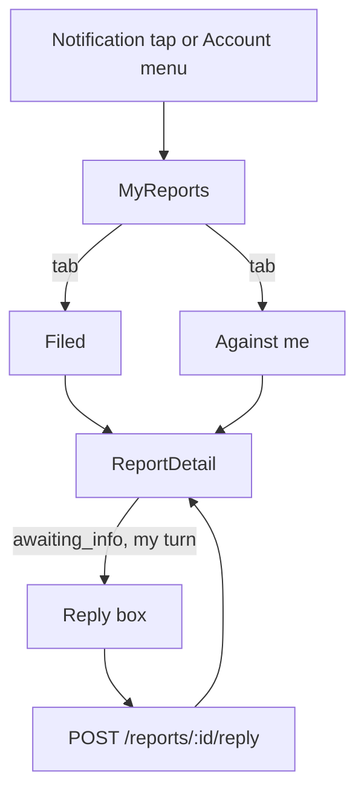
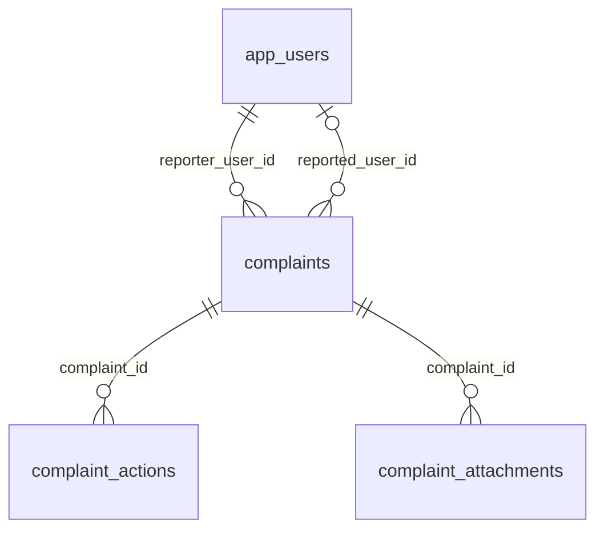

# Module 50 · Complaint History

> **Phase 15 · Complaints** · **Used by:** Any user (as reporter or as the reported party) · **Depends on:** M49 (files the case); Admin M43 (owns triage, enforcement and closure) · **New tables:** none · **Uses:** `complaints`, `complaint_actions`, `complaint_attachments`, `app_users`, `audit_logs` · **Build estimate:** 2–3 days

## 1. Module Purpose

Lets any user see the safety cases they are involved in — either as the one who reported, or as the one who was reported — follow the status without seeing internal admin notes, reply when an admin asks for more information, and read the final outcome message. It is the app-side mirror of Admin M43's case timeline, filtered to what each side is allowed to see.

## 2. User Stories

- As a **parent**, I want to check on the report I filed against a teacher so that I know it's being looked at.
- As a **teacher**, I want to see that someone reported me and reply to the admin's question so that I can give my side.
- As a **student**, I want to read the outcome message once a case closes so that I know what happened.
- As an **institute counsellor**, I want my case list to clearly separate reports I filed from ones filed against my institute's staff.

## 3. Business Rules & Logic

**BR-50.1 My reports list.** `GET /reports` returns `complaints` where `reporter_user_id = sub` OR `reported_user_id = sub` (or, for institute staff, `reported_institute_id` in an institute they actively manage), split into two client-side tabs by a `side` field the API adds per row: `"filed"` or `"against_me"`. Cursor-paginated, newest `created_at` first; filter chips: status (`open`, `in_review`, `awaiting_info`, `escalated`, `resolved`, `dismissed` — grouped in the UI as Open / Closed) and side.
**BR-50.2 Case detail — reporter view.** `GET /reports/:id` when `reporter_user_id = sub`: full `reported` summary (name, role, photo — the caller already knows who they reported), case number, type, severity, status, SLA state (`open`/`in_review`/etc. shown as a friendly stage, not raw SLA hours), and the outcome once closed (`resolution`, `reporterMessage`). No admin identity is shown, only "Support team".
**BR-50.3 Case detail — reported-party view.** `GET /reports/:id` when `reported_user_id = sub` or the caller staffs `reported_institute_id`: the `reporter` object is never included (BR-49.7); the case is shown as "A user reported you" with the complaint type and a support-written summary line, never the raw `description` (which may itself identify the reporter). Only entries relevant to enforcement or information requests aimed at this side are shown; there is no separate outcome message field for this side — a warning or suspension arrives as its own notification (Admin M43 FR-43.4), not through this endpoint.
**BR-50.4 Timeline.** Built from `complaint_actions WHERE complaint_id = :id AND is_internal = false`, oldest first. Each row is rendered by `action`: `created` ("Report filed" / "You were reported", depending on side), `info_requested` (shows `note` as the question, with a "Reply" button when it targets the viewer's side and `status = 'awaiting_info'`), `note` authored by an app user (a stored reply — see BR-50.5) shown as a chat bubble on "your" side, `warning_issued`/`suspended`/`escalated`/`resolved`/`dismissed`/`reopened` shown as status-change chips with the visible portion of their `note`. Rows where `metadata` would reveal the other party's identity are never sent to the app regardless of `is_internal`.
**BR-50.5 Reply to an information request.** `POST /reports/:id/reply { message }`, allowed only when `status = 'awaiting_info'` and the most recent `info_requested` action's `metadata.to` equals the caller's side (`reporter` or `reported`) — otherwise `CONFLICT_STATE` (`details.reason = "no_open_request"`). In one transaction: insert `complaint_actions` (`action = 'note'`, `is_internal = false`, `note = message`, `admin_id = null`, `metadata = { "repliedBy": "reporter" | "reported" }`), then update `complaints.status = 'in_review'` (mirrors Admin M43 FR-43.3 "reply received"). Each open information request accepts exactly one reply; a second attempt after replying (before a new request) → `CONFLICT_STATE` ("You've already replied. We'll follow up soon.").
**BR-50.6 Outcome message.** When `status IN ('resolved','dismissed')`, the reporter's case detail shows `reporterMessage` as the closing line; the reported party's case detail never shows `reporterMessage` (it is written for the reporter) — they see only that the case is closed, plus any warning/suspension notice they separately received.
**BR-50.7 Reopen visibility.** If Admin reopens a closed case (`status → in_review` via `reopened`), both sides simply see the status return to "In review" on next refresh/push; no extra action is needed from the app.

## 4. Screen List

| Screen | Route name | Purpose |
| --- | --- | --- |
| My reports | `MyReports` | Tabs: Filed / Against me; status filter |
| Report detail | `ReportDetail` | Timeline, reply box when open |

## 5. Screen Flow & Navigation


Back from `ReportDetail` always returns to the tab it was opened from, preserving scroll position and filters.

## 6. Screen Wireframe Description

**MyReports** — header "My reports", segmented control "Filed (3)" / "Against me (1)". Filter chip row "All · Open · Closed". Rows: case number "CS-4471", type pill "Fraud", status pill ("In review" amber, "Resolved" green, "Awaiting your reply" red with a dot when it's the viewer's turn), target name for Filed tab ("Dr. Ananya Iyer") or "A user" for Against-me tab, date "Filed 12 Sep 2026". Empty (Filed): "You haven't filed any reports."; Empty (Against me): "No one has reported you."

**ReportDetail (Filed)** — header "Case CS-4471", status pill, "Reported: Dr. Ananya Iyer" with avatar, type "Fraud", "Filed 12 Sep 2026". Timeline cards top-to-bottom: "Report filed" · "Support team requested more information: 'Can you share the payment screenshot again in full resolution?'" with "Reply" button · your reply bubble · "Resolved — Your report was upheld. We've taken action against this account." (green card). If open: sticky reply box "Type your reply…" with "Send" (disabled under 10 chars, hidden when not your turn).

**ReportDetail (Against me)** — header "Case CS-4471", status pill, body "A user reported you for Fraud on 12 Sep 2026.", no reporter details shown. Timeline: "Support team requested more information: 'Please explain the payment you received outside the app.'" with Reply button when open; your past reply; closing card "This case is closed." (no reporter message shown here).

## 7. UI Components & Component Tree

```
MyReportsScreen
├─ SegmentedTabs (Filed / Against me)
├─ FilterChips (status)
└─ FlashList<ReportRow>
ReportDetailScreen
├─ CaseHeader (case number, status pill, type)
├─ CaseTimeline (FlashList<TimelineItem>)
└─ ReplyBox (sticky, conditional)
```
- `ReportRow({ report, onPress })`, `TimelineItem({ action, note, side, timestamp })`.
- Hooks: `useReportsQuery(side, status)`, `useReportDetailQuery(id)`, `useReplyToReportMutation(id)`.

## 8. Validation Rules

| Field | Rule | Message shown |
| --- | --- | --- |
| reply message | 10–1,000 chars | "Write a bit more before sending (10 characters minimum)." |
| reply timing | only while `status = awaiting_info` and it's the caller's turn | Reply box hidden; if raced, toast "This request has already been answered." |

## 9. API Endpoints

| Method | Path | Auth | Description |
| --- | --- | --- | --- |
| GET | /reports | Any user | My cases, filed or against me, cursor-paginated |
| GET | /reports/:id | Any user | Case detail with side-filtered timeline |
| POST | /reports/:id/reply | Any user | Reply to an open information request (Idempotency-Key) |

## 10. Request Payloads

```json
// GET /reports?side=filed&status=open&limit=20

// POST /reports/:id/reply   (Idempotency-Key: 5b1a…)
{ "message": "Here's the payment screenshot again, in full resolution — attached in the original report." }
```

## 11. Response Payloads

```json
// 200 GET /reports
{ "data": [ { "id": "…", "caseNumber": "CS-4471", "side": "filed", "complaintType": "fraud", "status": "awaiting_info",
  "myTurn": true, "counterparty": { "type": "teacher", "name": "Dr. Ananya Iyer" }, "createdAt": "2026-09-12T09:00:00Z" } ],
  "meta": { "nextCursor": null } }

// 200 GET /reports/:id   (side = against_me)
{ "data": { "id": "…", "caseNumber": "CS-4471", "side": "against_me", "complaintType": "fraud", "status": "in_review",
  "createdAt": "2026-09-12T09:00:00Z",
  "timeline": [ { "action": "created", "at": "2026-09-12T09:00:00Z" },
    { "action": "info_requested", "at": "2026-09-13T11:00:00Z", "note": "Please explain the payment you received outside the app.", "myTurn": true },
    { "action": "note", "at": "2026-09-13T15:20:00Z", "note": "It was a gift from the family, not a fee — I can share the message.", "authoredByMe": true } ] } }

// 409 no open request
{ "error": { "code": "CONFLICT_STATE", "message": "There's no open request to reply to right now.",
  "details": { "reason": "no_open_request" }, "requestId": "…" } }
```

## 12. PostgreSQL Tables & Columns


**Existing tables this module reads or writes** (full definitions in the owning module)

| Table | Owner | Purpose |
| --- | --- | --- |
| `complaints` | Admin M43 | Two-way safety reports: learners about teachers/institutes, teachers about parents/students. |
| `complaint_actions` | Admin M43 | Case timeline: assignments, notes, warnings, suspensions, escalations. |
| `complaint_attachments` | Admin M43 | Evidence files attached to a complaint. |
| `app_users` | Admin M00 | Login identity for every mobile app account (parent, student, teacher, institute staff). Role profiles hang off this table. |
| `audit_logs` | Admin M00 | Append-only record of every admin action and security event. Never updated or deleted by the application. |

- `complaints`: read-only here except `status` on reply (`awaiting_info → in_review`), which this module is allowed to set as the one exception to "Admin owns transitions" (mirrors Admin M43 FR-43.3 exactly).
- `complaint_actions`: read filtered to `is_internal = false`; the one write is a `note` row on reply.
- `complaint_attachments`: the reporter's own evidence thumbnails are shown on their "Filed" case detail (their own uploads); never shown to the reported party.

## 13. Relationships


**Entity relationship diagram** (tables this module uses; `admins` omitted)



## 14. State Management

- Query keys: `reportsKeys.list(side, status)`, `reportsKeys.detail(id)`. `useReplyToReportMutation` invalidates `reportsKeys.detail(id)` and `reportsKeys.list('*')` (both tabs, since `myTurn`/status changed).
- No Zustand store; the reply text is local component state (short-lived, not worth persisting).

## 15. Offline Handling

- `GET /reports` and `GET /reports/:id` are persisted queries (24 h cache); read fully offline with "Updated 2 h ago".
- Reply is **online only** (conventions §8 class 3) — it changes a case's SLA-relevant status and must reach the server; the reply box is disabled offline with a hint, and typed text is kept in local state until the screen closes so a brief drop doesn't lose it.

## 16. Push Notification Requirements

| Event | Recipient | Title / Body | Deep link | Category | Urgent |
| --- | --- | --- | --- | --- | --- |
| Information requested | Whichever side (reporter or reported) | "We need more information" / "Reply to case CS-4471 to help us investigate." | `gc://reports/:id` | complaints | No |
| Case resolved/dismissed | Reporter only | "Update on your report" / "There's an update on case CS-4471." | `gc://reports/:id` | complaints | No |
The reported party gets no push when the case is merely created or merely resolved/dismissed (BR-49.6/BR-50.6) — only when their reply is needed or when a separate enforcement notice is sent (owned by Admin M43's pipeline, not this module).

## 17. Security Rules

- Every row is scoped by `reporter_user_id = sub` OR `reported_user_id = sub` OR institute staff membership — never by an id in the request body.
- The reported-party response shape is a distinct, smaller DTO with no reporter fields, built server-side (not a client-side filter of the reporter's shape), so a compromised client can't recover hidden fields.
- Reply text is scanned by the same contact-info detector as review text (M34) and warned inline, though not blocked, since sharing a phone number with support staff here is legitimate; the description is a hint only, not a hard rule enforced server-side for this endpoint.
- Rate limit: 10 replies/hour per user across all their cases.

## 18. Error Handling

| Scenario | Code | HTTP | App behaviour |
| --- | --- | --- | --- |
| Reply outside an open window | `CONFLICT_STATE` | 409 | Toast, refetch (box hides if truly closed) |
| Reply too short | `VALIDATION_FAILED` | 422 | Inline under the reply box |
| Case not found / not yours | `NOT_FOUND` | 404 | "This case is no longer available." |

## 19. Testing Scenarios

- T50.1 Reporter opens a filed case, sees full reported-party summary and the outcome message once resolved.
- T50.2 Reported party opens the same case (their "Against me" tab) → no reporter fields anywhere in the payload; outcome message absent even after resolution.
- T50.3 Admin requests info from the reporter → reporter's `myTurn = true`, reply box shown; reported party's copy shows `myTurn = false`, no reply box.
- T50.4 Reply submitted → status flips to `in_review`; a second reply attempt before a new request → `CONFLICT_STATE`.
- T50.5 Reply under 10 chars → inline validation, not sent.
- T50.6 Offline: reply box disabled with hint; typed text preserved if the screen is backgrounded and resumed.
- T50.7 Case reopened by admin after being resolved → both sides' status refreshes to "In review" on next pull-to-refresh.
- T50.8 Institute counsellor opens "Against me" tab → sees a case where `reported_institute_id` is their institute, even though `reported_user_id` is null.
- T50.9 Push tap on "Information requested" opens directly to `ReportDetail` with the reply box focused.
- T50.10 Pagination: 25 filed cases → first page 20, `nextCursor` set; second page loads the remaining 5.

## 20. Audit Log Events

`app.report_reply_sent` — reply submitted (case number, side; reply text is not logged, mirroring the description's own exclusion from audit logs).

## 21. Future Scalability Notes

- Push a small "days since last update" indicator on long-open cases so users don't feel forgotten (paired with Admin M43's SLA breach view).
- Read receipts on info requests so support knows the user has seen the question before the 7-day auto-transition.
- A "was this outcome fair?" one-tap feedback on resolved cases, separate from the app-store rating prompt.
