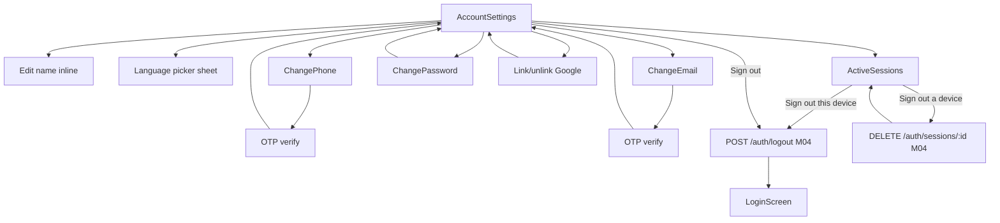
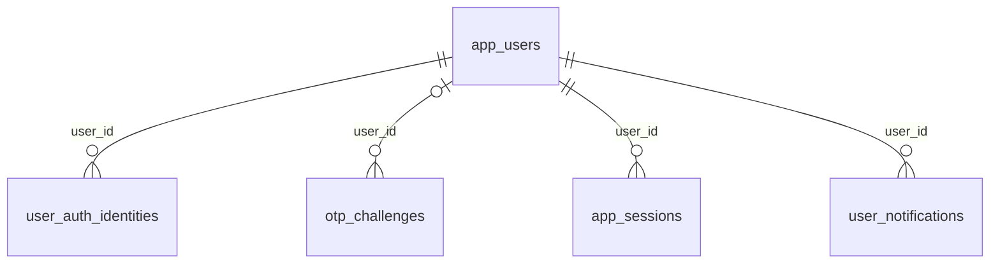

# Module 51 · Account Settings

> **Phase 16 · Settings** · **Used by:** Any user (parent, student, teacher, institute staff) · **Depends on:** M00 (uploads for profile photo), M04 (OTP, sessions, refresh — Active Sessions and Sign out reuse M04 endpoints directly); Admin M00 (app_users) · **New tables:** none · **Uses:** `app_users`, `user_auth_identities`, `otp_challenges`, `app_sessions`, `audit_logs`, `user_notifications` · **Build estimate:** 4–5 days

## 1. Module Purpose

The single place every user manages their identity and how they sign in: display name and app language, changing phone or email with OTP proof, setting or changing a password, linking or unlinking Google Sign-In, and reviewing/revoking the devices they're signed in on. It owns no new tables — it edits `app_users` and `user_auth_identities` and reuses M04's session endpoints — but it is the module every other settings screen (M52–M54) hangs off.

## 2. User Stories

- As a **teacher**, I want to change my phone number after switching SIMs without losing my account or verification history.
- As a **parent**, I want to set a password so I can sign in even if I don't have OTP access for a moment (foreign roaming, dead SIM).
- As **any user**, I want to link my Google account so I have a backup way to sign in.
- As a **security-conscious teacher**, I want to see every device signed into my account and sign out the ones I don't recognise.
- As a **student**, I want to change my display language to Hindi and have the whole app switch immediately.

## 3. Business Rules & Logic

**BR-51.1 `GET /account`.** Returns `fullName`, `phone` (own number, shown in full — this is the owner, not another user), `email`, `preferredLanguage`, `accountStatus`, and `authMethods`: one entry per active `user_auth_identities` row (`phone` always present, `password` present once set, `google` present once linked) plus `linkedGoogleEmail` when linked. `updatedAt` from `app_users` is the `If-Match` version for `PATCH /account`.
**BR-51.2 `PATCH /account`.** Updates `full_name` (2–80 chars) and/or `preferred_language` (`en`, `hi`, `kn`, `ta`, `te`, `mr`, `bn`) with `If-Match`; stale match → `VERSION_CONFLICT`. A language change updates `i18next` immediately app-wide (no restart) and is sent as `Accept-Language` on subsequent requests, driving push/email template language.
**BR-51.3 Change phone.** `POST /account/phone/otp { newPhone }` — rejects if `newPhone` already belongs to another active `app_users` row (`CONFLICT_DUPLICATE`); creates an `otp_challenges` row (`purpose = 'change_phone'`, `channel = 'sms'`, `destination = newPhone`), 6-digit code, 10-minute expiry, resend after 30 s, 5 attempts before `OTP_LOCKED` (10 min lock). `POST /account/phone/verify { code }` checks the challenge (`attempts`, `expires_at`, `consumed_at IS NULL`), then in one transaction: `app_users.phone = newPhone`, `phone_verified_at = now()`, and the `user_auth_identities` row with `provider = 'phone'` gets `provider_subject = newPhone`. `otp_challenges.consumed_at = now()`.
**BR-51.4 Change email.** Same shape as BR-51.3 with `purpose = 'change_email'`, `channel = 'email'`; `email` is case-insensitive (`citext`) and checked for an existing active owner the same way; on success sets `app_users.email`, `email_verified_at`, and updates the `password` identity's `email` column if one exists (password sign-in uses email as the identifier).
**BR-51.5 Set or change password.** `PUT /account/password`. If no active `user_auth_identities` row with `provider = 'password'` exists yet, this is a **set**: the request carries an `otpCode` verified against a fresh challenge with `purpose = 'reset_password'` sent to the phone or email on file (there is no old password to confirm, so the flow reuses the same server-side check as M04's forgot-password) plus `newPassword`; a `password` identity row is inserted (`password_hash`, `password_updated_at`). If a password identity already exists, this is a **change**: the request instead carries `currentPassword`, verified with a constant-time hash compare against `password_hash` (3 wrong attempts in an hour → `locked_until` set, `OTP_LOCKED`-style 429), and `newPassword`. Either way `newPassword` must be 8–72 chars with at least one upper-case letter, one lower-case letter and one digit, and must not equal the current password. On success: `password_updated_at = now()`, `failed_attempts = 0`, and every **other** `app_sessions` row for the user is revoked (`revoked_reason = 'password_changed'`) — the current session is kept so the user isn't logged out of the device they're using.
**BR-51.6 Link Google.** `POST /account/identities/google { idToken }` — the server verifies the token with Google's tokeninfo endpoint (audience must match the app's OAuth client id), extracting `sub` and `email`. If a **different** `app_users` already has a `google` identity with that `provider_subject` → `CONFLICT_DUPLICATE` ("This Google account is already linked to another profile."). Otherwise upserts the caller's `google` identity (`provider_subject`, `email`).
**BR-51.7 Unlink an identity.** `DELETE /account/identities/:id` soft-deletes (`deleted_at = now()`) the named `user_auth_identities` row, only for `provider IN ('password','google')` — the `phone` identity can never be unlinked from here (it is the account's primary identifier; changing it is BR-51.3, not unlinking). Rejected with `CONFLICT_STATE` ("Add another way to sign in before removing this one.") if it would leave the account with zero active identities besides `phone` when phone sign-in is currently disabled for the account, or more simply: rejected only when it is the user's **only** active identity of any kind, which in practice never happens since `phone` is permanent — so this guard exists purely to keep the invariant true if a future migration ever allows unlinking phone.
**BR-51.8 Active sessions and sign-out.** This screen calls M04's `GET /auth/sessions` (list of `app_sessions`: device model, platform, `last_used_at`, a `current: true` flag on `sid` from the token) and `DELETE /auth/sessions/:id` to revoke one. "Sign out" on this device calls M04's `POST /auth/logout`; "Sign out all other devices" calls M04's `POST /auth/logout-all` (keeps the current session).
**BR-51.9 Security notifications.** Any successful phone change, email change, password change/set, or Google link/unlink sends `user_notifications` to the account (category `account`, not urgent) with the device/time, so an owner who didn't take the action is alerted.

## 4. Screen List

| Screen | Route name | Purpose |
| --- | --- | --- |
| Account settings | `AccountSettings` | Name, language, sign-in methods, sessions, sign out |
| Change phone | `ChangePhone` | New phone → OTP |
| Change email | `ChangeEmail` | New email → OTP |
| Set/change password | `ChangePassword` | Current + new, or OTP + new |
| Active sessions | `ActiveSessions` | Device list, revoke |

## 5. Screen Flow & Navigation


Any step of ChangePhone/ChangeEmail can be backed out of before OTP verification with no side effect; after verification there is no undo (change is live), so the OTP screen states "This becomes your sign-in number/email once verified."

## 6. Screen Wireframe Description

**AccountSettings** — header "Account". Row "Name" — "Lakshmi Venkatesh" with edit pencil (inline text field on tap, Save/Cancel). Row "Language" — "English" → opens a sheet with the 7 supported languages, radio-selected. Section "Sign in & security": "Phone number" "+91 98765 43210" → Change; "Email" "lakshmi.v@gmail.com" → Change (or "Add email" if none); "Password" "Not set" → "Set password" (or "•••••••• · Change" if set); "Google account" "Not linked" → "Link" (or "linked as lakshmi.v@gmail.com" → "Unlink"). Section "Devices": "Active sessions (3)" → ActiveSessions. Sticky-free list; bottom of screen "Sign out" (destructive text button) and, below it, small link "Delete account" (→ M54).

**ChangePhone** — step 1: field "New phone number" +91 prefix, 10 digits, button "Send code"; step 2: 6-box OTP input, "Code sent to +91 90000 00001", countdown "Resend in 0:24", button "Verify and update".

**ActiveSessions** — rows: device icon, "SM-A546E · Android 14" (or "This device" badge), "Last active 2 h ago" / "Active now" for current, trailing "Sign out" text button (hidden for current — replaced by the bottom "Sign out this device" instead). Top button "Sign out of all other devices".

## 7. UI Components & Component Tree

```
AccountSettingsScreen
├─ EditableRow (name)
├─ LanguagePickerSheet
├─ SecuritySection (phone, email, password, google rows)
├─ DevicesSection (sessions summary row)
└─ SignOutRow · DeleteAccountLink
ChangePhoneScreen / ChangeEmailScreen
├─ ContactField
└─ OtpInput
ChangePasswordScreen (current+new or otp+new, chosen by hasPasswordIdentity)
ActiveSessionsScreen
├─ FlashList<SessionRow>
└─ Button "Sign out of all other devices"
```
- Hooks: `useAccountQuery()`, `useUpdateAccountMutation()`, `useRequestPhoneOtpMutation()`, `useVerifyPhoneMutation()`, `useRequestEmailOtpMutation()`, `useVerifyEmailMutation()`, `useSetOrChangePasswordMutation()`, `useLinkGoogleMutation()`, `useUnlinkIdentityMutation()`, `useSessionsQuery()` (M04), `useRevokeSessionMutation()` (M04).

## 8. Validation Rules

| Field | Rule | Message shown |
| --- | --- | --- |
| fullName | 2–80 chars | "Enter your full name." |
| preferredLanguage | one of en, hi, kn, ta, te, mr, bn | — (picker only) |
| newPhone | +91 and 10 digits, not already active on another account | "This number is already registered." |
| newEmail | valid email, not already active on another account | "This email is already registered." |
| otp code | 6 digits | "Enter the 6-digit code." |
| currentPassword | required when a password identity exists | "Enter your current password." |
| newPassword | 8–72 chars, upper + lower + digit, ≠ current | "Use 8+ characters with a mix of letters and a number." |
| google idToken | valid, audience matches app | "Couldn't verify your Google account." |

## 9. API Endpoints

| Method | Path | Auth | Description |
| --- | --- | --- | --- |
| GET | /account | Any user | Profile and linked sign-in methods |
| PATCH | /account | Any user | Update name / language (If-Match) |
| POST | /account/phone/otp | Any user | Send OTP to a new phone |
| POST | /account/phone/verify | Any user | Verify and apply the new phone |
| POST | /account/email/otp | Any user | Send OTP to a new email |
| POST | /account/email/verify | Any user | Verify and apply the new email |
| PUT | /account/password | Any user | Set or change the password |
| POST | /account/identities/google | Any user | Link a Google account |
| DELETE | /account/identities/:id | Any user | Unlink password or Google |

## 10. Request Payloads

```json
// PATCH /account   (If-Match: "2026-09-01T10:00:00Z")
{ "fullName": "Lakshmi Venkatesh", "preferredLanguage": "hi" }

// POST /account/phone/otp
{ "newPhone": "+919000000001" }

// POST /account/phone/verify
{ "code": "482913" }

// PUT /account/password   (existing password)
{ "currentPassword": "OldPass123", "newPassword": "NewPass456" }

// PUT /account/password   (first-time set)
{ "otpCode": "482913", "newPassword": "NewPass456" }
```

## 11. Response Payloads

```json
// 200 GET /account
{ "data": { "fullName": "Lakshmi Venkatesh", "phone": "+919876543210", "email": "lakshmi.v@gmail.com", "preferredLanguage": "en",
  "accountStatus": "active", "authMethods": [ { "provider": "phone" }, { "provider": "password" } ], "linkedGoogleEmail": null,
  "updatedAt": "2026-09-01T10:00:00Z" } }

// 200 POST /account/phone/verify
{ "data": { "phone": "+919000000001", "phoneVerifiedAt": "2026-09-26T10:15:00Z" } }

// 409 duplicate phone
{ "error": { "code": "CONFLICT_DUPLICATE", "message": "This number is already registered to another account.",
  "requestId": "…" } }
```

## 12. PostgreSQL Tables & Columns


**Existing tables this module reads or writes** (full definitions in the owning module)

| Table | Owner | Purpose |
| --- | --- | --- |
| `app_users` | Admin M00 | Login identity for every mobile app account (parent, student, teacher, institute staff). Role profiles hang off this table. |
| `user_auth_identities` | App M04 | Sign-in methods linked to an account: phone OTP, email + password, Google. |
| `otp_challenges` | App M04 | One-time codes sent by SMS or email for login, sign-up, contact changes and account deletion. |
| `app_sessions` | App M04 | Refresh-token sessions for app users, one per signed-in install. Refresh tokens rotate on every use. |
| `audit_logs` | Admin M00 | Append-only record of every admin action and security event. Never updated or deleted by the application. |
| `user_notifications` | App M00 | The in-app notification inbox for every user: transactional events and copies of admin campaigns. |

- `app_users`: `full_name`, `preferred_language`, `phone`/`phone_verified_at`, `email`/`email_verified_at` are edited here; `account_status` is read-only (owned by Admin M43 enforcement and M54 deletion).
- `user_auth_identities`: one row per provider is fully owned by this module's link/unlink/change flows; `failed_attempts`/`locked_until` gate password changes.
- `otp_challenges`: reused with purposes `change_phone`, `change_email`, `reset_password` (for first-time password set) — this module never introduces a new purpose value.
- `app_sessions`: written only as a side effect of `password_changed` revocation (BR-51.5); listing and per-row revoke are M04's endpoints, reused, not redefined here.

## 13. Relationships


**Entity relationship diagram** (tables this module uses; `admins` omitted)



## 14. State Management

- Query keys: `accountKeys.me`. Every successful mutation invalidates `accountKeys.me`; `useSetOrChangePasswordMutation` also invalidates M04's `sessionsKeys.list` (other sessions disappear).
- No dedicated Zustand store; `preferredLanguage` on success also updates the global `useSession` claim copy so tab labels and dates re-render immediately.

## 15. Offline Handling

- `GET /account` is a persisted query (readable offline).
- `PATCH /account` (name/language) is **save draft, submit online**: editing is allowed offline, the Save button is disabled with a hint, and the local edit is kept until it can be sent.
- Phone/email OTP, password changes, and Google link/unlink are **online only** (conventions §8 class 3) — every one of them is a security-sensitive action.

## 16. Push Notification Requirements

| Event | Recipient | Title / Body | Deep link | Category | Urgent |
| --- | --- | --- | --- | --- | --- |
| Phone changed | Self | "Phone number updated" / "Your sign-in number was changed to •••• 0001." | `gc://account` | account | No |
| Email changed | Self | "Email updated" / "Your sign-in email was changed." | `gc://account` | account | No |
| Password set/changed | Self | "Password updated" / "Your password was changed. If this wasn't you, contact support." | `gc://account` | account | No |
| Google linked/unlinked | Self | "Google account linked" / "unlinked" | `gc://account` | account | No |

## 17. Security Rules

- Every endpoint scopes by `sub`; there is no path that accepts another user's id.
- `PUT /account/password` and the OTP-verify calls are rate-limited tighter than the default (10/hour) and never logged with the code or password itself.
- FLAG_SECURE on `ChangePhone`, `ChangeEmail` and `ChangePassword` (OTP/credential entry).
- Changing phone or email does not by itself revoke other sessions (BR-51.3/51.4 note) — only a password change does, since phone/email changes are already OTP-proven on the new destination and a stolen-device attacker who changes them would need OTP access anyway; sessions are still listed so the user can manually revoke any they don't recognise.
- Google `idToken` is verified server-side on every call; the client never trusts the decoded token locally for identity.

## 18. Error Handling

| Scenario | Code | HTTP | App behaviour |
| --- | --- | --- | --- |
| Stale If-Match on PATCH /account | `VERSION_CONFLICT` | 409 | "Updated elsewhere. Review and save again." |
| New phone/email already active elsewhere | `CONFLICT_DUPLICATE` | 409 | Inline on the field |
| Wrong OTP | `OTP_INVALID` | 422 | Inline under the code field |
| Too many OTP attempts | `OTP_LOCKED` | 429 | "Too many attempts. Try again in 10 minutes." |
| Wrong current password, 3rd time | `AUTH_REFRESH_INVALID`-style lock (`OTP_LOCKED`) | 429 | "Too many attempts. Try again in an hour." |
| Weak new password | `VALIDATION_FAILED` | 422 | Inline under the field |
| Google account linked elsewhere | `CONFLICT_DUPLICATE` | 409 | "This Google account is linked to another profile." |
| Unlink the account's last identity | `CONFLICT_STATE` | 409 | "Add another way to sign in first." |

## 19. Testing Scenarios

- T51.1 Update name and language → saved, app language switches immediately; Maestro flow `account_update_profile`.
- T51.2 Change phone: request OTP, verify with correct code → phone updated, security push received.
- T51.3 Change phone to a number already active on another account → `CONFLICT_DUPLICATE` before any OTP is sent.
- T51.4 6th wrong OTP attempt → `OTP_LOCKED` for 10 minutes.
- T51.5 First-time password set via OTP → `password` identity appears in `authMethods`; can now sign in with email + password (M04).
- T51.6 Change existing password with wrong current password 3 times → locked; correct password blocked for an hour.
- T51.7 Successful password change → all other sessions revoked (verified via `GET /auth/sessions` showing only current); current session still works.
- T51.8 Link Google already linked to a second account → `CONFLICT_DUPLICATE`.
- T51.9 Unlink Google when password also exists → succeeds; unlink password when Google doesn't exist and it's the only non-phone identity → still succeeds (phone always remains).
- T51.10 Offline: name edited, Save disabled with hint; reconnect → Save enabled, submits.
- T51.11 Sign out this device from ActiveSessions → returns to Login; sign out all other devices → current session unaffected, others gone from the list.

## 20. Audit Log Events

| Event | When | Details |
| --- | --- | --- |
| `app.profile_updated` | `PATCH /account` succeeds | changed fields (no values for sensitive ones) |
| `app.phone_changed` | Phone verify succeeds | masked old/new number |
| `app.email_changed` | Email verify succeeds | masked old/new email |
| `app.password_changed` | Password set/change succeeds | whether it was a first set |
| `app.identity_linked` / `app.identity_unlinked` | Google link/unlink | provider |

## 21. Future Scalability Notes

- Apple Sign-In as a second social provider once iOS volume justifies it.
- Passkeys (WebAuthn) as a phishing-resistant alternative to password.
- Step-up re-authentication (fresh OTP) before especially sensitive actions like unlinking the only backup identity.
- Session naming ("iPhone 14 · Bengaluru") using IP geolocation, shown next to the device model.
- Email change confirmation on both old and new addresses (currently only the new one is OTP-verified) once email deliverability is proven reliable.
