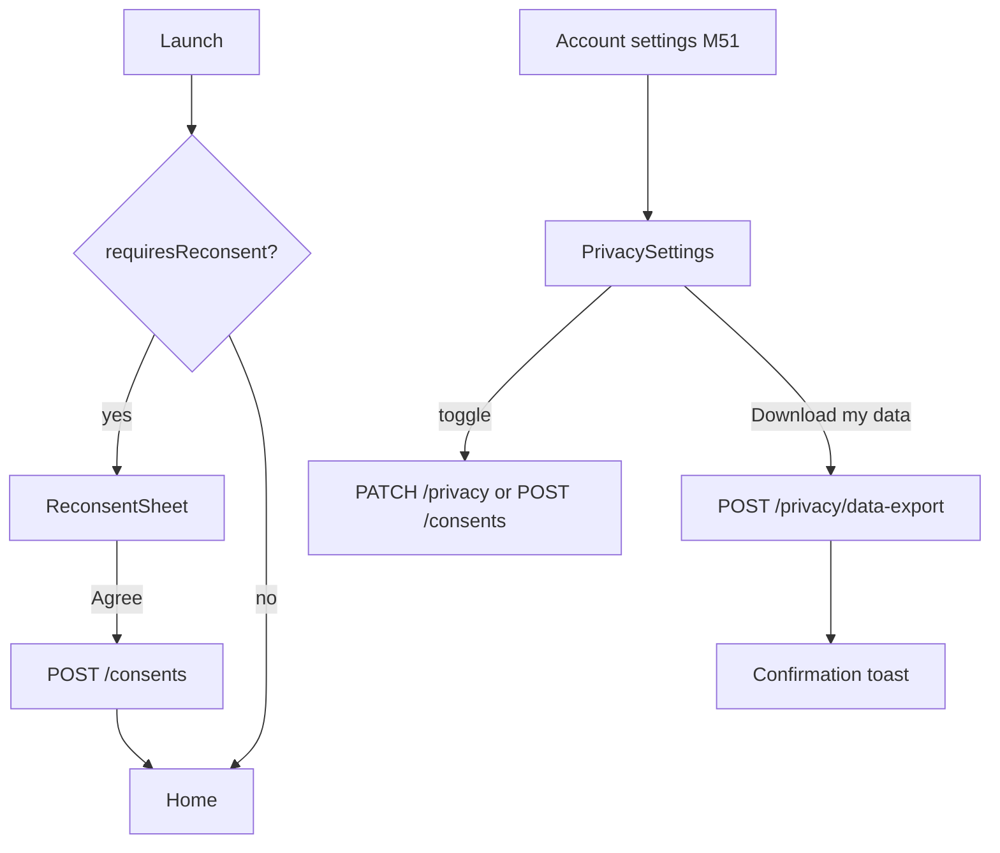
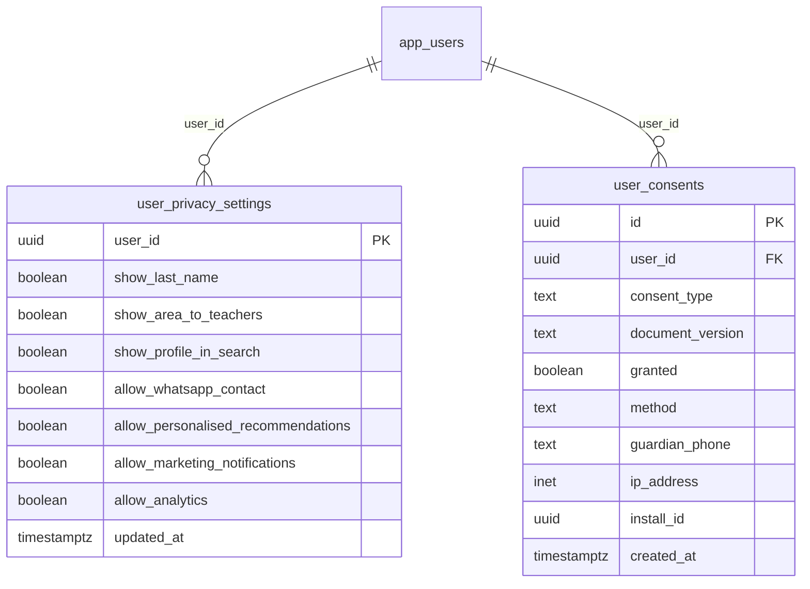

# Module 52 · Privacy Settings

> **Phase 16 · Settings** · **Used by:** Any user · **Depends on:** M00, M51 (entry point); Admin M04 (legal document versions), M05/M06/M11/M14/M21 (write the initial terms/privacy consents at registration) · **New tables:** `user_privacy_settings`, `user_consents` · **Uses:** `app_users`, `audit_logs` · **Build estimate:** 3 days

## 1. Module Purpose

What a user shows to others and allows the platform to do with their data, and the DPDP Act 2023 consent record behind it. Owns `user_privacy_settings` (display and data-use toggles) and `user_consents` (an append-only, auditable ledger of every consent granted or withdrawn — terms, privacy policy, marketing, personalisation, parental consent, minor data processing). Also handles the "download my data" request.

## 2. User Stories

- As a **parent**, I want to hide my area from teachers I haven't contacted yet so that I control who sees where I live.
- As a **teacher**, I want to turn off personalised recommendations if I don't want my activity used that way.
- As **any user**, I want to withdraw marketing consent without losing access to the app.
- As a **privacy-conscious student**, I want to download a copy of my data.
- As **any user**, I want to be told clearly when the Terms or Privacy Policy change and need my consent again.

## 3. Business Rules & Logic

**BR-52.1 `GET /privacy`.** Reads `user_privacy_settings WHERE user_id = sub`; a missing row (never toggled) returns the defaults: `show_last_name = false`, `show_area_to_teachers = true`, `show_profile_in_search = true`, `allow_whatsapp_contact = true`, `allow_personalised_recommendations = true`, `allow_marketing_notifications = false`, `allow_analytics = true` — the row is created lazily on first `PATCH`.
**BR-52.2 `PATCH /privacy`.** Partial update of the six display/behaviour toggles (`show_last_name`, `show_area_to_teachers`, `show_profile_in_search`, `allow_whatsapp_contact`, `allow_analytics`) with `If-Match` on `updated_at`. `allow_personalised_recommendations` and `allow_marketing_notifications` can also be read here but are **written only** through `POST /consents` (BR-52.4), so the two screens stay in sync from one source of truth; `PATCH /privacy` rejects those two fields with `VALIDATION_FAILED` if sent (`details.reason = "use_consents_endpoint"`).
**BR-52.3 Effect of toggles.** `show_profile_in_search = false` excludes teachers/institutes from M27/M28 search and M30 recommendations within one indexing cycle (≤ 15 min); `allow_analytics = false` makes M00's `POST /events` accept only `app_open`/`crash` (BR-0.10); `allow_whatsapp_contact = false` hides the WhatsApp share/contact option on the profile (M33, M37); `show_last_name = false` shows reviews and lead requester names as first name + last initial everywhere.
**BR-52.4 `GET /consents` / `POST /consents`.** `GET /consents` returns, per `consent_type`, the latest `user_consents` row (`granted`, `document_version`, `created_at`) — this is a read of the most recent row per type, not a full history, though the raw history is retained for compliance. `POST /consents { consentType, granted, method }` **always inserts a new row** (append-only ledger; never updates) with `user_id = sub`, `document_version` = the current published version for that type (from `system_settings`), `method` (`toggle` from this screen, `checkbox`/`otp`/`email_link` from other flows), `ip_address`, `install_id`. For `consentType IN ('marketing','personalisation')`, the same transaction also upserts the matching `user_privacy_settings` boolean (`allow_marketing_notifications`, `allow_personalised_recommendations`) so `GET /privacy` and `GET /consents` never disagree. `terms`/`privacy_policy`/`parental_consent`/`data_processing_minor` consents are not withdrawable from this screen (withdrawing them means the account can't be used) — attempting `granted: false` on those types → `CONFLICT_STATE` ("You can't withdraw this while keeping your account. You can delete your account instead.").
**BR-52.5 Re-consent on document change.** `GET /consents` includes `requiresReconsent: true` for `terms`/`privacy_policy` when the latest granted row's `document_version` is older than the currently published version (`system_settings` keys `legal.terms_version`, `legal.privacy_version`). When true, the app shows a blocking `ReconsentSheet` on next launch (dismissible only by agreeing) before any other screen; agreeing calls `POST /consents { consentType, granted: true, method: 'checkbox' }` with the new version.
**BR-52.6 Data export.** `POST /privacy/data-export` starts a job that compiles the caller's data (profile, children, leads, reviews, transactions summary, complaints they filed, consent history) into a password-protected ZIP, uploaded to `gc-private`, and emails a 72-hour download link to the verified email on file (falls back to "add an email first" if none — `CONFLICT_STATE`, `details.reason = "email_required"`). No new table is added for this: the request is throttled with a Redis key `export:<userId>` (one request per 30 days; a second call inside the window → `LIMIT_REACHED`, `details.reason = "export_cooldown"`, `details.availableAt`) and recorded in `audit_logs` (`app.data_export_requested`) rather than its own row.

## 4. Screen List

| Screen | Route name | Purpose |
| --- | --- | --- |
| Privacy settings | `PrivacySettings` | Display toggles, consents, data export |
| Reconsent | `ReconsentSheet` (blocking modal) | Forces agreement to an updated Terms/Privacy Policy |

## 5. Screen Flow & Navigation


`ReconsentSheet` has no dismiss/back action; it reappears on every launch until agreed.

## 6. Screen Wireframe Description

**PrivacySettings** — header "Privacy". Section "What others see": switches "Show my last name" (off), "Show my area to teachers" (on), "Appear in search results" (on). Section "Contact & recommendations": "Allow WhatsApp contact option" (on), "Personalised recommendations" (on) with helper "Uses your searches and saved teachers to suggest better matches.". Section "Communication": "Marketing notifications" (off) helper "Offers and product updates. Turning this off still lets you get account and lead alerts.". Section "Data": "Analytics" (on) helper "Helps us fix bugs and improve the app. Never includes your name, phone or messages.". Section "Your consents" — read-only rows: "Terms of Service · v3 · Agreed 2 Jan 2026", "Privacy Policy · v2 · Agreed 2 Jan 2026" with an info icon linking to the document. Button "Download my data" → confirm sheet "We'll email a download link to lakshmi.v@gmail.com within 72 hours." → "Request".

**ReconsentSheet** — heading "We've updated our Privacy Policy", body summary of what changed (from `system_settings`), link "Read the full policy", single button "I agree and continue" (no other way through).

## 7. UI Components & Component Tree

```
PrivacySettingsScreen
├─ ToggleSection ×3
├─ ConsentHistoryList (read-only)
└─ DataExportRow → ExportConfirmSheet
ReconsentSheet (blocking modal)
```
- Hooks: `usePrivacyQuery()`, `useUpdatePrivacyMutation()`, `useConsentsQuery()`, `useSetConsentMutation()`, `useRequestDataExportMutation()`.

## 8. Validation Rules

| Field | Rule | Message shown |
| --- | --- | --- |
| privacy toggle fields | boolean; `allow_marketing_notifications`/`allow_personalised_recommendations` rejected on this endpoint | — (routed to the right call in the client) |
| consentType | one of terms, privacy_policy, marketing, personalisation, parental_consent, data_processing_minor | — |
| granted:false on terms/privacy_policy/parental_consent/data_processing_minor | rejected | "You can't withdraw this while keeping your account." |
| data export | one request per 30 days | "You can request another export on 26 Oct 2026." |

## 9. API Endpoints

| Method | Path | Auth | Description |
| --- | --- | --- | --- |
| GET | /privacy | Any user | Current privacy settings (defaults if unset) |
| PATCH | /privacy | Any user | Update display/behaviour toggles (If-Match) |
| GET | /consents | Any user | Latest consent per type, `requiresReconsent` flag |
| POST | /consents | Any user | Grant or withdraw a consent (Idempotency-Key) |
| POST | /privacy/data-export | Any user | Request a data export email (rate limited) |

## 10. Request Payloads

```json
// PATCH /privacy   (If-Match: "2026-09-01T10:00:00Z")
{ "showLastName": false, "showAreaToTeachers": true, "allowWhatsappContact": false }

// POST /consents   (Idempotency-Key: 2fa1…)
{ "consentType": "marketing", "granted": false, "method": "toggle" }

// POST /privacy/data-export
{}
```

## 11. Response Payloads

```json
// 200 GET /privacy
{ "data": { "showLastName": false, "showAreaToTeachers": true, "showProfileInSearch": true, "allowWhatsappContact": true,
  "allowPersonalisedRecommendations": true, "allowMarketingNotifications": false, "allowAnalytics": true,
  "updatedAt": "2026-08-01T09:00:00Z" } }

// 200 GET /consents
{ "data": [ { "consentType": "terms", "granted": true, "documentVersion": "3", "grantedAt": "2026-01-02T08:00:00Z" },
  { "consentType": "marketing", "granted": false, "documentVersion": "1", "grantedAt": "2026-09-10T09:00:00Z" } ],
  "meta": { "requiresReconsent": false } }

// 202 POST /privacy/data-export
{ "data": { "requestedAt": "2026-09-26T10:15:00Z", "estimatedByAt": "2026-09-29T10:15:00Z" } }

// 429 export cooldown
{ "error": { "code": "LIMIT_REACHED", "message": "You can request another export on 26 Oct 2026.",
  "details": { "reason": "export_cooldown", "availableAt": "2026-10-26T10:15:00Z" }, "requestId": "…" } }
```

## 12. PostgreSQL Tables & Columns

**New tables owned by this module** (migration `sql/migrations/152_app_m52_privacy_settings_privacy_and_consents.sql`)

### `user_privacy_settings`

What a user shows to others and allows the platform to do with their data.

| Column | Type | Null | Default | Constraints / References | Description |
| --- | --- | --- | --- | --- | --- |
| `user_id` | uuid | no | — | PK; FK → `app_users.id` (on delete cascade) | Owner |
| `show_last_name` | boolean | no | false | — | Reviews show "Lakshmi V." when false |
| `show_area_to_teachers` | boolean | no | true | — | Teachers see the area on leads |
| `show_profile_in_search` | boolean | no | true | — | Teachers/institutes: listed in search (false = paused listing) |
| `allow_whatsapp_contact` | boolean | no | true | — | Show a WhatsApp button once contact is unlocked |
| `allow_personalised_recommendations` | boolean | no | true | — | Use search history and children for recommendations |
| `allow_marketing_notifications` | boolean | no | true | — | Announcements and offers |
| `allow_analytics` | boolean | no | true | — | Product analytics events |
| `updated_at` | timestamptz | no | now() | — | Updated |

<details><summary>DDL</summary>

```sql
CREATE TABLE user_privacy_settings (
  user_id uuid PRIMARY KEY REFERENCES app_users(id) ON DELETE CASCADE, -- Owner
  show_last_name boolean NOT NULL DEFAULT false, -- Reviews show "Lakshmi V." when false
  show_area_to_teachers boolean NOT NULL DEFAULT true, -- Teachers see the area on leads
  show_profile_in_search boolean NOT NULL DEFAULT true, -- Teachers/institutes: listed in search (false = paused listing)
  allow_whatsapp_contact boolean NOT NULL DEFAULT true, -- Show a WhatsApp button once contact is unlocked
  allow_personalised_recommendations boolean NOT NULL DEFAULT true, -- Use search history and children for recommendations
  allow_marketing_notifications boolean NOT NULL DEFAULT true, -- Announcements and offers
  allow_analytics boolean NOT NULL DEFAULT true, -- Product analytics events
  updated_at timestamptz NOT NULL DEFAULT now() -- Updated
);

CREATE TRIGGER trg_user_privacy_settings_updated BEFORE UPDATE ON user_privacy_settings FOR EACH ROW EXECUTE FUNCTION set_updated_at();
```

</details>

### `user_consents`

Record of every consent given or withdrawn (terms, privacy policy, parental consent, marketing), as required by the DPDP Act 2023.

| Column | Type | Null | Default | Constraints / References | Description |
| --- | --- | --- | --- | --- | --- |
| `id` | uuid | no | gen_random_uuid() | PK | Primary key |
| `user_id` | uuid | no | — | FK → `app_users.id` (on delete cascade) | Data principal |
| `consent_type` | text | no | — | CHECK consent_type IN ('terms','privacy_policy','marketing','personalisation','parental_consent','data_processing_minor') | What |
| `document_version` | text | no | — | — | e.g. privacy-2026-09 |
| `granted` | boolean | no | — | — | true = given, false = withdrawn |
| `method` | text | no | — | CHECK method IN ('checkbox','otp','toggle','email_link') | How it was captured |
| `guardian_phone` | text | yes | — | — | For parental consent: verified guardian phone |
| `ip_address` | inet | yes | — | — | IP |
| `install_id` | uuid | yes | — | — | Install |
| `created_at` | timestamptz | no | now() | — | When |

<details><summary>DDL</summary>

```sql
CREATE TABLE user_consents (
  id uuid PRIMARY KEY DEFAULT gen_random_uuid(), -- Primary key
  user_id uuid NOT NULL REFERENCES app_users(id) ON DELETE CASCADE, -- Data principal
  consent_type text NOT NULL CHECK (consent_type IN ('terms','privacy_policy','marketing','personalisation','parental_consent','data_processing_minor')), -- What
  document_version text NOT NULL, -- e.g. privacy-2026-09
  granted boolean NOT NULL, -- true = given, false = withdrawn
  method text NOT NULL CHECK (method IN ('checkbox','otp','toggle','email_link')), -- How it was captured
  guardian_phone text, -- For parental consent: verified guardian phone
  ip_address inet, -- IP
  install_id uuid, -- Install
  created_at timestamptz NOT NULL DEFAULT now() -- When
);
CREATE INDEX idx_user_consents_user ON user_consents (user_id, consent_type, created_at DESC);
```

</details>

**Indexes:** `idx_user_consents_user` on `(user_id, consent_type, created_at DESC)`

**Existing tables this module reads or writes** (full definitions in the owning module)

| Table | Owner | Purpose |
| --- | --- | --- |
| `app_users` | Admin M00 | Login identity for every mobile app account (parent, student, teacher, institute staff). Role profiles hang off this table. |
| `audit_logs` | Admin M00 | Append-only record of every admin action and security event. Never updated or deleted by the application. |

- `user_privacy_settings`: one row per user, created lazily on first write; six of its eight columns are edited directly by `PATCH /privacy`, the other two only via `POST /consents`.
- `user_consents`: append-only; `GET /consents` reads the latest row per `(user_id, consent_type)` (`DISTINCT ON` ordered by `created_at DESC`); registration modules (M05/M06/M11/M14/M21) insert the first `terms`/`privacy_policy`/`parental_consent`/`data_processing_minor` rows, this module inserts every row after that.

## 13. Relationships

**Foreign keys of new tables**

- `user_privacy_settings.user_id` → `app_users` — required, many-to-one, on delete **cascade**
- `user_consents.user_id` → `app_users` — required, many-to-one, on delete **cascade**

**Entity relationship diagram**



## 14. State Management

- Query keys: `privacyKeys.settings`, `privacyKeys.consents`. Both invalidate each other on the two consent types that are shared; `useRequestDataExportMutation` has no cache effect beyond a success toast.
- `useAppFlags` gains `reconsentBlockedUntilAgreed: boolean`, checked by the root navigator before any other route.

## 15. Offline Handling

- `GET /privacy` and `GET /consents` are persisted queries.
- All writes here (`PATCH /privacy`, `POST /consents`, data export) are **online only** — they affect what the platform is allowed to do with the user's data and must be confirmed by the server, not queued speculatively.

## 16. Push Notification Requirements

| Event | Recipient | Title / Body | Deep link | Category | Urgent |
| --- | --- | --- | --- | --- | --- |
| Data export ready | Self | "Your data export is ready" / "Check lakshmi.v@gmail.com for your download link." | `gc://account/privacy` | account | No |
Email is the primary channel for the export link itself (it's a downloadable file, not something to open in-app); the push is a heads-up only.

## 17. Security Rules

- `user_privacy_settings`/`user_consents` rows are always scoped to `sub`; no endpoint accepts another user's id.
- The export ZIP is password-protected (a one-time code shown in-app, not in the email) and the R2 object is deleted by a job after the 72-hour link expiry.
- `ip_address`/`install_id` are stored on each `user_consents` row for DPDP audit purposes but never surfaced back to the user or any other module.
- Withdrawing `allow_analytics` takes effect on the **next** `POST /events` call; events already batched client-side before the toggle are still flushed (they were captured under the prior consent) but no new ones are queued.

## 18. Error Handling

| Scenario | Code | HTTP | App behaviour |
| --- | --- | --- | --- |
| Stale If-Match | `VERSION_CONFLICT` | 409 | "Updated elsewhere. Review and save again." |
| Withdraw terms/privacy/parental/minor consent | `CONFLICT_STATE` | 409 | Explains the account-vs-consent tradeoff, offers Delete account |
| Marketing/personalisation sent to PATCH /privacy | `VALIDATION_FAILED` | 422 | Handled client-side (never actually reaches the server) |
| Export requested twice within 30 days | `LIMIT_REACHED` | 429 | Sheet shows the next available date |
| No verified email for export | `CONFLICT_STATE` | 409 | "Add an email address first." → M51 |

## 19. Testing Scenarios

- T52.1 First-ever `GET /privacy` (no row) → documented defaults returned; first `PATCH` creates the row.
- T52.2 Turn off "Appear in search results" → teacher no longer appears in M27 search within the next indexing pass (integration test against the search index job).
- T52.3 `POST /consents {marketing:false}` → `user_consents` gets a new row, `user_privacy_settings.allow_marketing_notifications` flips to false, `GET /privacy` reflects it immediately.
- T52.4 Attempt to withdraw `terms` → `CONFLICT_STATE`.
- T52.5 Bump `legal.terms_version` in `system_settings` → next `GET /consents` returns `requiresReconsent: true`; app shows the blocking sheet on launch; agreeing clears the flag.
- T52.6 Request data export → 202, cooldown recorded; second request the same day → `LIMIT_REACHED` with the correct `availableAt`.
- T52.7 Turn off `allow_analytics` → subsequent `POST /events` from M00 only accepts `app_open`/`crash`.
- T52.8 Offline: toggles disabled with hint; no optimistic flip (this module's writes are online-only, unlike M40's favourites).

## 20. Audit Log Events

| Event | When | Details |
| --- | --- | --- |
| `app.privacy_settings_updated` | `PATCH /privacy` | which fields changed |
| `app.consent_changed` | `POST /consents` | consent type, granted, document version |
| `app.data_export_requested` | `POST /privacy/data-export` | none sensitive (email not logged) |

## 21. Future Scalability Notes

- A dedicated `data_export_requests` table once export volume needs a status/history UI beyond "one request every 30 days".
- Granular per-teacher visibility (hide my activity from a specific teacher) beyond the global search-visibility toggle.
- Consent captured per-language document version, so re-consent prompts show the policy in the user's own language.
- Automated DPDP grievance-officer routing for data-principal requests beyond export (correction, erasure — erasure already lives in M54).
