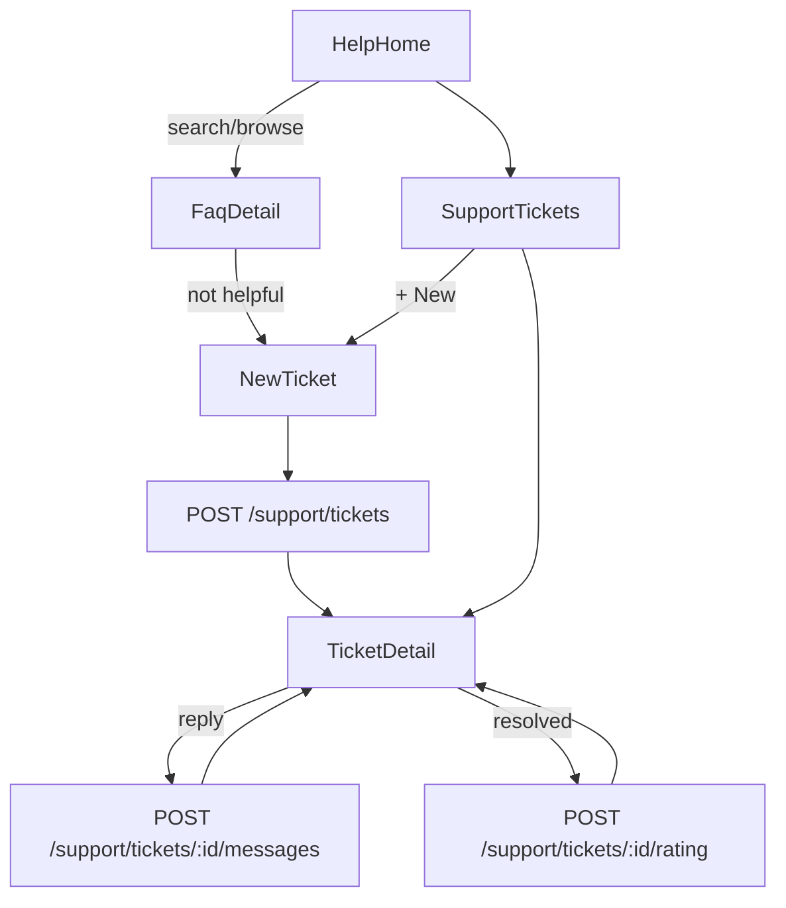
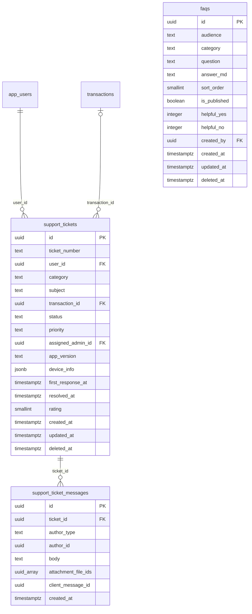

# Module 53 · Help & Support

> **Phase 16 · Settings** · **Used by:** Any user (FAQ browsing also Public, signed out) · **Depends on:** M00 (uploads, bootstrap support contacts), M40 (link a ticket to a transaction); Admin (ticket queue is an Admin portal addition — see Scalability) · **New tables:** `faqs`, `support_tickets`, `support_ticket_messages` · **Uses:** `transactions`, `files`, `app_users`, `user_notifications`, `audit_logs` · **Build estimate:** 4 days

## 1. Module Purpose

The help centre and support-ticket system: searchable FAQs by audience and category, the contact options shown from `GET /bootstrap`, and a ticketing flow with automatic device diagnostics, evidence attachments, a conversation thread, and a post-resolution rating. Not for safety reports — those are M49/M50's `complaints`; this module is for account, payment, verification, technical and feedback issues.

## 2. User Stories

- As a **new parent**, I want to search "how do I add a child" and get an answer instantly without contacting anyone.
- As a **teacher whose payment failed**, I want to raise a ticket linked to that specific transaction so support has the context already.
- As a **student on a 2G connection**, I want the ticket form to attach my device info automatically so I don't have to describe my phone.
- As **any user**, I want to see all my past tickets and reopen one instead of starting over.
- As **any user**, I want to rate the support I received once my ticket is resolved.

## 3. Business Rules & Logic

**BR-53.1 `GET /faqs`.** Returns published FAQs (`is_published = true`, `deleted_at IS NULL`) matching `audience IN ('all', :role)` (signed out → `'all'` only), optionally filtered by `category` (`getting_started`, `account`, `payments`, `verification`, `leads_demos`, `reviews`, `safety`, `privacy`) and a free-text `q` matched against `question` and `answer_md` (server-side `ILIKE`, ranked by a simple relevance score — exact question match first, then word overlap), ordered by `sort_order` within category. Cached client-side 24 h (masters-style ETag on the max `updated_at`).
**BR-53.2 `POST /faqs/:id/feedback { helpful }`.** Atomically increments `helpful_yes` or `helpful_no`. Limited to one vote per `(installId, faqId)` per 24 h via a Redis key (`RATE_LIMITED` silently ignored client-side — the button just shows "Thanks for your feedback" either way, since a soft double-vote isn't worth surfacing an error for).
**BR-53.3 Contact options.** `HelpHome` also renders `support.email`, `support.phone`, `support.whatsapp`, `support.hours` from `GET /bootstrap` (M01) — tapping opens the mail/dialer/WhatsApp app; these are not endpoints owned here.
**BR-53.4 Create a ticket.** `POST /support/tickets { category, subject, transactionId?, message, attachmentFileIds? }` inserts one `support_tickets` row (`status = 'open'`, `priority = 'normal'` unless `category = 'payment'` and `transactionId` maps to a `transactions` row with `status = 'failed'` in the last 24 h → `priority = 'high'`) plus, in the same transaction, one `support_ticket_messages` row (`author_type = 'app_user'`, `author_id = sub`, `body = message`, `attachment_file_ids`). `app_version`, `device_info` (`{ platform, osVersion, appVersion, buildNumber, deviceModel, netType }`) are attached automatically by the client, never typed by the user; `ticket_number` is server-assigned (`ST-` + a per-year sequence, matching the `case_number` pattern used for complaints). `transactionId`, if given, must belong to `sub` (`FORBIDDEN` otherwise).
**BR-53.5 Attachments.** Up to 5 files per message, `image/jpeg`, `image/png`, `application/pdf`, ≤ 10 MB each, purpose `support_attachment` (private), uploaded via M00 presign first, same shape as M49's evidence.
**BR-53.6 Conversation.** `POST /support/tickets/:id/messages { clientMessageId, body, attachmentFileIds? }` — allowed while `status IN ('open','awaiting_user','in_progress','resolved')`; `closed` tickets reject with `CONFLICT_STATE` ("This ticket is closed. Start a new one.") and the app hides the composer, showing "Start a new ticket" instead. `ON CONFLICT (author_id, client_message_id) DO NOTHING` then return the existing row (idempotent offline replay, same pattern as M37 lead messages). A user message on a `resolved` ticket reopens it to `in_progress`. `first_response_at` is set by the admin side (read-only here) and shown as "Typically replies within 4 hours" context copy on the ticket list, derived from a rolling average, not a per-ticket promise.
**BR-53.7 Rating.** `POST /support/tickets/:id/rating { rating }` (1–5), allowed only when `status IN ('resolved','closed')` and `rating IS NULL` (already-rated → `CONFLICT_STATE`, `details.reason = "already_rated"`); sets `support_tickets.rating`.
**BR-53.8 List and detail.** `GET /support/tickets` (cursor, newest first, filter by `status`); `GET /support/tickets/:id` returns the ticket plus every `support_ticket_messages` row (`author_type` drives the bubble side: `app_user` = right/"You", `admin` = left/"Support", `system` = centred note e.g. "Ticket assigned to Priya").

## 4. Screen List

| Screen | Route name | Purpose |
| --- | --- | --- |
| Help home | `HelpHome` | FAQ search, categories, contact options |
| FAQ detail | `FaqDetail` | Answer, was-this-helpful |
| My tickets | `SupportTickets` | List with status |
| New ticket | `NewTicket` | Category, subject, message, attachments |
| Ticket detail | `TicketDetail` | Conversation thread, composer, rating |

## 5. Screen Flow & Navigation


`FaqDetail`'s "Still need help?" button pre-fills `NewTicket`'s category from the FAQ's category. `NewTicket` after submit replaces itself with `TicketDetail` (no back to the empty form).

## 6. Screen Wireframe Description

**HelpHome** — search bar "Search for help", category chips (Getting started, Account, Payments, Verification, Leads & demos, Reviews, Safety, Privacy). Below: top FAQ list per selected category, each row question + chevron. Section "Contact us": rows "Call us" +91 80471 82200, "WhatsApp", "Email support@guruconnect.in", small text "Mon–Sat, 9 AM–7 PM". Sticky bottom "My tickets" button (badge with open ticket count).

**FaqDetail** — question as header, `answer_md` rendered (bold, links, lists), divider, "Was this helpful?" with 👍/👎 buttons (one disables both after tap, "Thanks for your feedback"), button "Still need help? Contact support" if 👎 or always visible below.

**NewTicket** — picker "What's this about?" (category chips), field "Subject" placeholder "Payment failed for teacher registration fee", text area "Describe the issue", optional "Related payment" picker (recent transactions, only for Payment category), "Add screenshots" (up to 5), small note "We'll include your app version and device info automatically.", sticky button "Submit".

**TicketDetail** — header "ST-10042 · Payment issue", status pill, message bubbles top-to-bottom with timestamps, system notes centred grey ("Assigned to Priya (Support)"), sticky composer "Type a message…" + attach icon + Send. When `status = resolved` and unrated: banner "How was your support experience?" with 5 stars, tap to rate.

## 7. UI Components & Component Tree

```
HelpHomeScreen
├─ FaqSearchBar
├─ CategoryChips
├─ FaqList
└─ ContactOptionsSection
FaqDetailScreen
SupportTicketsScreen
├─ FlashList<TicketRow>
└─ FAB "New ticket"
NewTicketScreen
├─ CategoryChips · SubjectField · MessageField · TransactionPicker (conditional) · AttachmentPicker
└─ StickyActionBar "Submit"
TicketDetailScreen
├─ TicketHeader (status pill)
├─ FlashList<MessageBubble>
├─ RatingBanner (conditional)
└─ Composer (attach + send, hidden when closed)
```
- Hooks: `useFaqsQuery(category, q)`, `useFaqFeedbackMutation()`, `useTicketsQuery(status)`, `useTicketDetailQuery(id)`, `useCreateTicketMutation()`, `useSendTicketMessageMutation()`, `useRateTicketMutation()`. Device diagnostics collected by `lib/diagnostics.ts` (`getDeviceInfo()`), not a hook.

## 8. Validation Rules

| Field | Rule | Message shown |
| --- | --- | --- |
| category | one of account, payment, verification, technical, lead_demo, feedback, other | "Choose a topic." |
| subject | 5–120 chars | "Give it a short title (5+ characters)." |
| message | 10–3,000 chars | "Describe the issue (10 characters minimum)." |
| transactionId | must belong to the caller | — (picker only lists own transactions) |
| attachmentFileIds | ≤ 5, each active and owned | "Remove a file and try again." |
| ticket message body | 1–1,000 chars | "Type a message." |
| rating | integer 1–5, only once, only when resolved/closed | "Rating not available yet." |
| faq feedback | boolean, ≤ 1 per install per FAQ per day | — |

## 9. API Endpoints

| Method | Path | Auth | Description |
| --- | --- | --- | --- |
| GET | /faqs | Any user (also Public) | Search/browse FAQs |
| POST | /faqs/:id/feedback | Any user (also Public) | Was this helpful |
| GET | /support/tickets | Any user | My tickets, cursor-paginated |
| POST | /support/tickets | Any user | Create a ticket (Idempotency-Key) |
| GET | /support/tickets/:id | Any user | Ticket with full conversation |
| POST | /support/tickets/:id/messages | Any user | Send a message (Idempotency-Key via clientMessageId) |
| POST | /support/tickets/:id/rating | Any user | Rate a resolved/closed ticket |

## 10. Request Payloads

```json
// GET /faqs?category=payments&q=refund

// POST /support/tickets
{ "category": "payment", "subject": "Payment failed for teacher registration fee", "transactionId": "3f7a2b10-…",
  "message": "I was charged but registration still shows unpaid. Payment id pay_OZabc123.", "attachmentFileIds": ["b2e1…"] }

// POST /support/tickets/:id/messages   (Idempotency-Key via clientMessageId)
{ "clientMessageId": "0b1c2d3e-…", "body": "Any update on this?" }

// POST /support/tickets/:id/rating
{ "rating": 4 }
```

## 11. Response Payloads

```json
// 200 GET /faqs
{ "data": [ { "id": "…", "category": "payments", "question": "Why was I charged twice?", "helpfulYes": 128, "helpfulNo": 4 } ],
  "meta": { "version": "f-20260926-a1" } }

// 201 POST /support/tickets
{ "data": { "id": "…", "ticketNumber": "ST-10042", "status": "open", "priority": "high", "createdAt": "2026-09-26T10:15:00Z" } }

// 200 GET /support/tickets/:id
{ "data": { "id": "…", "ticketNumber": "ST-10042", "status": "in_progress", "category": "payment", "subject": "Payment failed for teacher registration fee",
  "messages": [ { "id": "…", "authorType": "app_user", "body": "I was charged but registration still shows unpaid.", "createdAt": "…" },
    { "id": "…", "authorType": "system", "body": "Ticket assigned to Priya (Support)", "createdAt": "…" },
    { "id": "…", "authorType": "admin", "body": "Checking with our payments team now.", "createdAt": "…" } ] } }
```

## 12. PostgreSQL Tables & Columns

**New tables owned by this module** (migration `sql/migrations/153_app_m53_help_and_support.sql`)

### `faqs`

Help-centre questions and answers shown in the app, by audience.

| Column | Type | Null | Default | Constraints / References | Description |
| --- | --- | --- | --- | --- | --- |
| `id` | uuid | no | gen_random_uuid() | PK | Primary key |
| `audience` | text | no | 'all' | CHECK audience IN ('all','parent','student','teacher','institute') | Who sees it |
| `category` | text | no | — | CHECK category IN ('getting_started','account','payments','verification','leads_demos','reviews','safety','privacy') | Section |
| `question` | text | no | — | — | Max 160 chars |
| `answer_md` | text | no | — | — | Markdown answer, max 3,000 chars |
| `sort_order` | smallint | no | 0 | — | Order within category |
| `is_published` | boolean | no | true | — | Hidden when false |
| `helpful_yes` | integer | no | 0 | — | "Was this helpful?" yes votes |
| `helpful_no` | integer | no | 0 | — | No votes |
| `created_by` | uuid | yes | — | FK → `admins.id` (on delete no action) | Author |
| `created_at` | timestamptz | no | now() | — | Created |
| `updated_at` | timestamptz | no | now() | — | Updated |
| `deleted_at` | timestamptz | yes | — | — | Soft delete |

<details><summary>DDL</summary>

```sql
CREATE TABLE faqs (
  id uuid PRIMARY KEY DEFAULT gen_random_uuid(), -- Primary key
  audience text NOT NULL DEFAULT 'all' CHECK (audience IN ('all','parent','student','teacher','institute')), -- Who sees it
  category text NOT NULL CHECK (category IN ('getting_started','account','payments','verification','leads_demos','reviews','safety','privacy')), -- Section
  question text NOT NULL, -- Max 160 chars
  answer_md text NOT NULL, -- Markdown answer, max 3,000 chars
  sort_order smallint NOT NULL DEFAULT 0, -- Order within category
  is_published boolean NOT NULL DEFAULT true, -- Hidden when false
  helpful_yes integer NOT NULL DEFAULT 0, -- "Was this helpful?" yes votes
  helpful_no integer NOT NULL DEFAULT 0, -- No votes
  created_by uuid REFERENCES admins(id), -- Author
  created_at timestamptz NOT NULL DEFAULT now(), -- Created
  updated_at timestamptz NOT NULL DEFAULT now(), -- Updated
  deleted_at timestamptz -- Soft delete
);
CREATE INDEX idx_faqs_audience ON faqs (audience, category, sort_order) WHERE is_published AND deleted_at IS NULL;
CREATE INDEX idx_faqs_search ON faqs USING gin (to_tsvector('english', question || ' ' || answer_md));
CREATE TRIGGER trg_faqs_updated BEFORE UPDATE ON faqs FOR EACH ROW EXECUTE FUNCTION set_updated_at();
```

</details>

**Indexes:** `idx_faqs_audience` on `(audience, category, sort_order) WHERE is_published AND deleted_at IS NULL`; `idx_faqs_search` on `USING gin (to_tsvector('english', question \|\| ' ' \|\| answer_md))`

### `support_tickets`

Support requests raised from the app (not safety reports — those are complaints).

| Column | Type | Null | Default | Constraints / References | Description |
| --- | --- | --- | --- | --- | --- |
| `id` | uuid | no | gen_random_uuid() | PK | Primary key |
| `ticket_number` | text | no | ('ST-' \|\| nextval('seq_ticket_number')) | — | e.g. ST-10001 |
| `user_id` | uuid | no | — | FK → `app_users.id` (on delete restrict) | Requester |
| `category` | text | no | — | CHECK category IN ('account','payment','verification','technical','lead_demo','feedback','other') | Topic |
| `subject` | text | no | — | — | 5–120 chars |
| `transaction_id` | uuid | yes | — | FK → `transactions.id` (on delete set null) | Related payment, if any |
| `status` | text | no | 'open' | CHECK status IN ('open','awaiting_user','in_progress','resolved','closed') | Lifecycle |
| `priority` | text | no | 'normal' | CHECK priority IN ('low','normal','high') | Set by rules (payment issues = high) |
| `assigned_admin_id` | uuid | yes | — | FK → `admins.id` (on delete no action) | Support owner |
| `app_version` | text | yes | — | — | Diagnostics captured on create |
| `device_info` | jsonb | yes | — | — | {"platform":"android","os":"14","model":"…"} |
| `first_response_at` | timestamptz | yes | — | — | First admin reply |
| `resolved_at` | timestamptz | yes | — | — | Resolved |
| `rating` | smallint | yes | — | CHECK rating BETWEEN 1 AND 5 | User satisfaction after resolution |
| `created_at` | timestamptz | no | now() | — | Created |
| `updated_at` | timestamptz | no | now() | — | Updated |
| `deleted_at` | timestamptz | yes | — | — | Soft delete |

<details><summary>DDL</summary>

```sql
CREATE TABLE support_tickets (
  id uuid PRIMARY KEY DEFAULT gen_random_uuid(), -- Primary key
  ticket_number text NOT NULL DEFAULT ('ST-' || nextval('seq_ticket_number')), -- e.g. ST-10001
  user_id uuid NOT NULL REFERENCES app_users(id) ON DELETE RESTRICT, -- Requester
  category text NOT NULL CHECK (category IN ('account','payment','verification','technical','lead_demo','feedback','other')), -- Topic
  subject text NOT NULL, -- 5–120 chars
  transaction_id uuid REFERENCES transactions(id) ON DELETE SET NULL, -- Related payment, if any
  status text NOT NULL DEFAULT 'open' CHECK (status IN ('open','awaiting_user','in_progress','resolved','closed')), -- Lifecycle
  priority text NOT NULL DEFAULT 'normal' CHECK (priority IN ('low','normal','high')), -- Set by rules (payment issues = high)
  assigned_admin_id uuid REFERENCES admins(id), -- Support owner
  app_version text, -- Diagnostics captured on create
  device_info jsonb, -- {"platform":"android","os":"14","model":"…"}
  first_response_at timestamptz, -- First admin reply
  resolved_at timestamptz, -- Resolved
  rating smallint CHECK (rating BETWEEN 1 AND 5), -- User satisfaction after resolution
  created_at timestamptz NOT NULL DEFAULT now(), -- Created
  updated_at timestamptz NOT NULL DEFAULT now(), -- Updated
  deleted_at timestamptz -- Soft delete
);
CREATE UNIQUE INDEX uq_support_tickets_number ON support_tickets (ticket_number);
CREATE INDEX idx_support_tickets_user ON support_tickets (user_id, created_at DESC) WHERE deleted_at IS NULL;
CREATE INDEX idx_support_tickets_queue ON support_tickets (status, priority, created_at) WHERE deleted_at IS NULL;
CREATE TRIGGER trg_support_tickets_updated BEFORE UPDATE ON support_tickets FOR EACH ROW EXECUTE FUNCTION set_updated_at();
```

</details>

**Indexes:** `uq_support_tickets_number` (unique) on `(ticket_number)`; `idx_support_tickets_user` on `(user_id, created_at DESC) WHERE deleted_at IS NULL`; `idx_support_tickets_queue` on `(status, priority, created_at) WHERE deleted_at IS NULL`

### `support_ticket_messages`

Conversation on a support ticket between the user and support staff.

| Column | Type | Null | Default | Constraints / References | Description |
| --- | --- | --- | --- | --- | --- |
| `id` | uuid | no | gen_random_uuid() | PK | Primary key |
| `ticket_id` | uuid | no | — | FK → `support_tickets.id` (on delete cascade) | Ticket |
| `author_type` | text | no | — | CHECK author_type IN ('app_user','admin','system') | Side |
| `author_id` | uuid | yes | — | — | app_users.id or admins.id |
| `body` | text | no | — | — | 1–3,000 chars |
| `attachment_file_ids` | uuid[] | no | '{}' | — | Up to 3 private screenshots (files) |
| `client_message_id` | uuid | yes | — | — | Idempotency for app-sent messages |
| `created_at` | timestamptz | no | now() | — | Sent |

<details><summary>DDL</summary>

```sql
CREATE TABLE support_ticket_messages (
  id uuid PRIMARY KEY DEFAULT gen_random_uuid(), -- Primary key
  ticket_id uuid NOT NULL REFERENCES support_tickets(id) ON DELETE CASCADE, -- Ticket
  author_type text NOT NULL CHECK (author_type IN ('app_user','admin','system')), -- Side
  author_id uuid, -- app_users.id or admins.id
  body text NOT NULL, -- 1–3,000 chars
  attachment_file_ids uuid[] NOT NULL DEFAULT '{}', -- Up to 3 private screenshots (files)
  client_message_id uuid, -- Idempotency for app-sent messages
  created_at timestamptz NOT NULL DEFAULT now() -- Sent
);
CREATE INDEX idx_support_ticket_messages_ticket ON support_ticket_messages (ticket_id, created_at);
CREATE UNIQUE INDEX uq_support_ticket_messages_client ON support_ticket_messages (ticket_id, client_message_id) WHERE client_message_id IS NOT NULL;
```

</details>

**Indexes:** `idx_support_ticket_messages_ticket` on `(ticket_id, created_at)`; `uq_support_ticket_messages_client` (unique) on `(ticket_id, client_message_id) WHERE client_message_id IS NOT NULL`

**Existing tables this module reads or writes** (full definitions in the owning module)

| Table | Owner | Purpose |
| --- | --- | --- |
| `transactions` | Admin M40 | Every payment attempt through Razorpay, plus refunds and reward payouts. Amounts in paise. |
| `files` | Admin M00 | Metadata for every uploaded object stored in S3 / Cloudflare R2. Binary content never touches PostgreSQL. |
| `app_users` | Admin M00 | Login identity for every mobile app account (parent, student, teacher, institute staff). Role profiles hang off this table. |
| `user_notifications` | App M00 | The in-app notification inbox for every user: transactional events and copies of admin campaigns. |
| `audit_logs` | Admin M00 | Append-only record of every admin action and security event. Never updated or deleted by the application. |

- `faqs`: read-only for the app; `helpful_yes`/`helpful_no` are the only columns the app increments.
- `support_tickets`: `status`, `priority`, `assigned_admin_id`, `first_response_at`, `resolved_at` are admin-owned transitions; the app only sets fields at creation and reads the rest.
- `support_ticket_messages`: `author_type = 'system'` rows are written by the admin-side assignment/status-change logic, not this module, but rendered here.
- `transactions`: read-only, to populate the "Related payment" picker and to set `priority = 'high'` automatically for a recently failed payment.

## 13. Relationships

**Foreign keys of new tables**

- `faqs.created_by` → `admins` — optional, many-to-one, on delete **no action**
- `support_tickets.user_id` → `app_users` — required, many-to-one, on delete **restrict**
- `support_tickets.transaction_id` → `transactions` — optional, many-to-one, on delete **set null**
- `support_tickets.assigned_admin_id` → `admins` — optional, many-to-one, on delete **no action**
- `support_ticket_messages.ticket_id` → `support_tickets` — required, many-to-one, on delete **cascade**

**Entity relationship diagram**



## 14. State Management

- Query keys: `faqsKeys.list(category, q)` (persisted), `ticketsKeys.list(status)`, `ticketsKeys.detail(id)`.
- `useSendTicketMessageMutation` is optimistic (appends the bubble immediately with a "sending" state, reconciled by `clientMessageId` when the server response/queue flush returns).

## 15. Offline Handling

- FAQs are persisted and fully readable offline (public, no personal data).
- Ticket creation is **save draft, submit online** (class 2): draft kept per category; diagnostics are recomputed fresh at submit time (not from the draft, since network type may have changed).
- Ticket messages are **queue offline** (class 1, idempotent via `clientMessageId`) exactly like M37 lead messages — sent automatically on reconnect, shown as "Sending…" then "Sent".
- Rating is online only (simple, infrequent, no benefit to queuing).

## 16. Push Notification Requirements

| Event | Recipient | Title / Body | Deep link | Category | Urgent |
| --- | --- | --- | --- | --- | --- |
| Support replied | Ticket owner | "Support replied" / "New message on ST-10042." | `gc://support/tickets/:id` | account | No |
| Ticket resolved | Ticket owner | "Your ticket is resolved" / "ST-10042 has been marked resolved. Let us know how we did." | `gc://support/tickets/:id` | account | No |

## 17. Security Rules

- Every ticket/message query scoped by `user_id = sub`; a ticket id belonging to another user → `NOT_FOUND` (not `FORBIDDEN`, so ticket existence isn't leaked).
- `device_info` never includes IMEI/serial, only OS/app version and model.
- Attachment bucket private, 60-second presigned GET, viewable by the owner and support staff only.
- FAQ endpoints are public and cached at the CDN edge for 5 minutes (no personal data).

## 18. Error Handling

| Scenario | Code | HTTP | App behaviour |
| --- | --- | --- | --- |
| Message on a closed ticket | `CONFLICT_STATE` | 409 | Composer hidden, "Start a new ticket" shown |
| Rate an already-rated ticket | `CONFLICT_STATE` | 409 | Rating banner hidden, refetch |
| Rate a ticket that isn't resolved/closed | `CONFLICT_STATE` | 409 | Rating control hidden client-side (defensive only) |
| transactionId not owned by caller | `FORBIDDEN` | 403 | Picker never lists it; defensive error if raced |
| Subject/message too short | `VALIDATION_FAILED` | 422 | Inline under the field |

## 19. Testing Scenarios

- T53.1 Search "refund" → matching FAQs ranked by relevance; tapping one opens `FaqDetail`.
- T53.2 👍 then 👎 on the same FAQ within a minute → only the first counts; second is silently absorbed, UI still thanks the user.
- T53.3 Create a payment ticket linked to a failed transaction → `priority = "high"`; ticket appears at the top of "My tickets".
- T53.4 Send a message while offline → shows "Sending…"; reconnect → delivered once, no duplicate (`clientMessageId`).
- T53.5 Admin resolves a ticket (simulated via seed) → push received, rating banner appears; rate 4★ → banner disappears, second rating attempt blocked.
- T53.6 Message on a `closed` ticket → `CONFLICT_STATE`, composer replaced with "Start a new ticket".
- T53.7 5 attachments upload, submit → all 5 linked to the first message.
- T53.8 `GET /support/tickets/:id` for a ticket owned by another user → `NOT_FOUND`.
- T53.9 Signed-out user opens Help → sees only `audience = all` FAQs, no "My tickets" section (prompted to sign in).
- T53.10 Diagnostics attached automatically match the device under test (platform, appVersion) without any user input.

## 20. Audit Log Events

| Event | When | Details |
| --- | --- | --- |
| `app.support_ticket_created` | `POST /support/tickets` | category, priority, whether a transaction was linked |
| `app.support_ticket_rated` | `POST /support/tickets/:id/rating` | rating value |
Ticket messages themselves are not separately audited (conventions §11 excludes ordinary conversational content; the ticket creation event already captures that a case was opened).

## 21. Future Scalability Notes

- In-app live chat for `technical`/`account` categories during support hours, falling back to async tickets outside them.
- Suggested FAQs ranked by the user's own recent activity (e.g. a failed payment surfaces the refund FAQ first).
- CSAT trend dashboard from `support_tickets.rating` (Admin side).
- Canned replies and macros for support agents (Admin side).
- Admin portal additions: a Support Tickets queue (list, filters by category/priority/status, assignment, SLA-style first-response tracking, reply composer with saved macros, rating dashboard) — `support_tickets`/`support_ticket_messages` have no admin screens in the Admin SRS pack today; this module's data model is ready for them.
