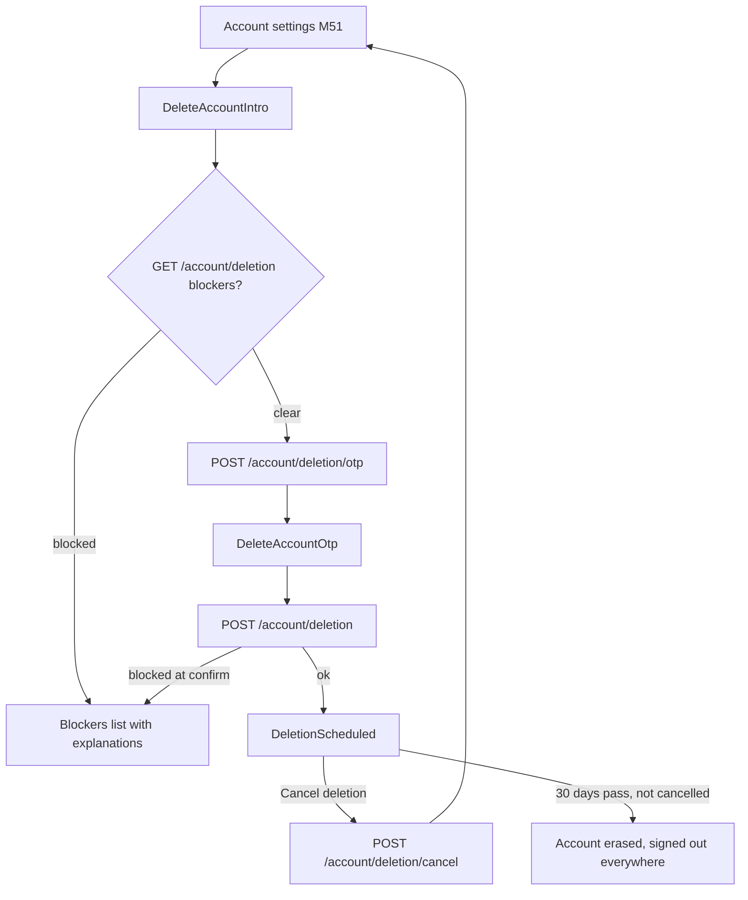
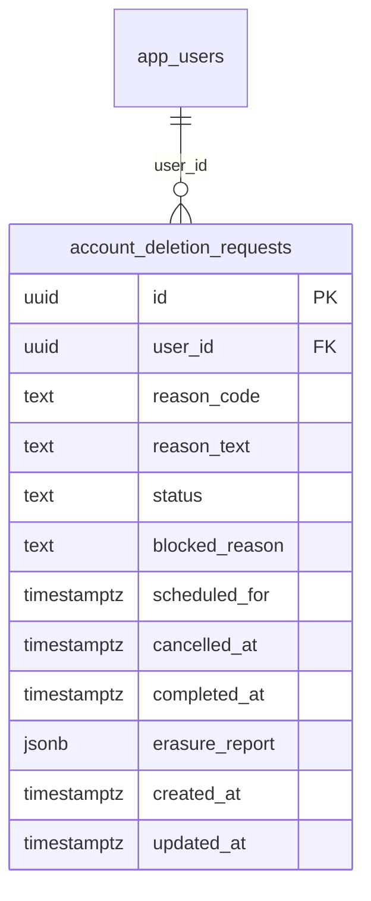

# Module 54 · Delete Account

> **Phase 16 · Settings** · **Used by:** Any user · **Depends on:** M51 (entry point), M04 (OTP, sessions), M40 (invoices retained), M42/M46 (referrals, wallet); Admin M43 (open-complaint blocker), Admin M40 (invoice retention), Admin M28/M31 (role rows erased) · **New tables:** `account_deletion_requests` · **Uses:** `app_users`, `app_sessions`, `user_devices`, `subscriptions`, `complaints`, `referrals`, `wallet_ledger`, `transactions`, `teacher_reviews`, `institute_reviews`, `audit_logs`, `user_notifications` · **Build estimate:** 3–4 days

## 1. Module Purpose

Lets a user permanently delete their account, as Google Play and the App Store require of any app that lets people create one: reachable in-app without contacting support, OTP-confirmed, with a 30-day grace period to change their mind, clear blockers when deletion isn't safe yet (an open safety case, a pending referral payout), and a precise line between what is erased, what is anonymised, and what is retained for legal reasons (GST invoices, safety records).

## 2. User Stories

- As a **parent who found a tutor**, I want to delete my account in a couple of taps without emailing anyone.
- As a **teacher**, I want to know why I can't delete yet if I have an open complaint, and what to do about it.
- As **anyone who changes their mind**, I want cancelling deletion to be as easy as signing back in.
- As a **privacy-conscious user**, I want to know exactly what happens to my reviews, payments and referral rewards when my account is gone.

## 3. Business Rules & Logic

**BR-54.1 `GET /account/deletion`.** Returns the caller's current request, if any (`none` when there isn't one), plus a live blocker check computed fresh on every call (not cached), so the screen always reflects reality:

| Blocker | Condition | `details.reason` |
| --- | --- | --- |
| Open safety case | A `complaints` row with `reporter_user_id = sub` OR `reported_user_id = sub`, `status IN ('open','in_review','awaiting_info','escalated')` | `open_complaint` |
| Pending referral payout | A `referrals` row with `referrer_user_id = sub`, `status = 'qualified'` (reward not yet released) | `pending_referral_payout` |
| Negative wallet balance | `SUM(wallet_ledger.amount_paise) WHERE user_id = sub < 0` | `negative_wallet_balance` |
None of these are permanent — the screen tells the user what will resolve each one (case closes, referral reward releases on schedule, balance is settled by a future credit) and lets them retry later; there is no way to force through a blocker from the app.
**BR-54.2 Request OTP.** `POST /account/deletion/otp` sends a code (`otp_challenges`, `purpose = 'delete_account'`) to the phone on file (or email if phone sign-in isn't the primary method), same throttling as other OTP purposes (30 s resend, 5 attempts → `OTP_LOCKED`). Blockers are **not** checked at this step — only at confirmation — so a user isn't told about a blocker before proving it's really them.
**BR-54.3 Confirm deletion.** `POST /account/deletion { code, reasonCode, reasonText? }` verifies the OTP, re-runs the blocker check from BR-54.1; any active blocker → `409 CONFLICT_STATE` (`details.reason` = the blocker's reason, `details.blockers` = the full list) and **no row is created**. With no blockers: inserts `account_deletion_requests` (`status = 'scheduled'`, `reason_code` one of `found_teacher`, `not_useful`, `privacy`, `too_many_notifications`, `duplicate_account`, `other`, `reason_text` ≤ 500 chars optional, `scheduled_for = now() + 30 days`). `app_users.account_status` is **not** changed to `suspended` — the account stays fully usable during the grace period (BR-54.4) except that active `subscriptions` with `auto_renew = true` are set `auto_renew = false` immediately (no surprise renewal into a deleted account).
**BR-54.4 Grace period and cancelling by signing in.** For 30 days the account works normally, with a persistent, dismiss-but-reappearing banner "Account scheduled for deletion on 26 Oct 2026" on Home and Account Settings. `POST /account/deletion/cancel` (no OTP required — being signed in with a valid session is proof enough, since cancelling only reduces harm) sets `status = 'cancelled'`, `cancelled_at = now()`; the banner disappears and the account continues exactly as before. Signing in during the grace period does not cancel automatically — the user must tap the banner's "Cancel deletion" action — but any sign-in is what makes that action reachable, which is what "cancelling by signing in" means in practice.
**BR-54.5 Execution (job at `scheduled_for`, only if still `status = 'scheduled'`).** Sets `status = 'processing'`, then in one transaction per user:
- **Erased:** `full_name` → `"Deleted user"`, `phone`/`email` → `null`, `profile_photo_file_id` → `null` (file deleted from R2); `app_users.deleted_at = now()`; role row (`parents`/`students`/`teachers`/`institute_managers`) `deleted_at = now()`; `user_devices` rows deleted and FCM tokens revoked; `user_search_history`, `saved_searches`, `user_favorites`, draft data — deleted outright.
- **Anonymised (kept for platform integrity, delinked from identity):** `teacher_reviews`/`institute_reviews` authored by the user keep their star rating and text (removing them would unfairly change a teacher's/institute's score) but the author is shown as "Former user" once `author`'s `app_users` row is scrubbed — no separate flag needed, since the join simply resolves to the scrubbed name; `complaints` rows keep `reporter_user_id`/`reported_user_id` pointing at the scrubbed `app_users` row (required by `ON DELETE RESTRICT`) and are retained 3 years after closure per Admin M43's own retention rule, then anonymised there.
- **Retained for legal reasons:** `transactions` (and their invoice PDFs) are kept in full for **8 years** under GST/Income Tax record-keeping rules, unmodified — a scrubbed `app_users` row still satisfies the foreign key; `wallet_ledger` history is kept (immutable ledger) but any positive balance is forfeited: one final row is appended (`entry_type = 'expiry'`, `amount_paise` = the negative of the remaining balance, `description = "Forfeited on account deletion"`), zeroing it (there is no cash payout capability in v1 — see M42/M46 scalability).
- `app_sessions`: every row revoked (`revoked_reason = 'account_deleted'`). `subscriptions`: any still-active row set `status = 'cancelled'`, `cancelled_by_type = 'system'`, `cancel_reason = 'account_deleted'`.
- `account_deletion_requests.status = 'completed'`, `completed_at = now()`, `erasure_report` = a small JSON summary (counts of rows erased/anonymised/retained per table) for support's future reference if the user ever asks what happened.
**BR-54.6 Store-policy compliance.** The "Delete account" entry point sits directly in Account Settings (M51), reachable within two taps of app open, without requiring the user to contact support first — satisfying Google Play's Data safety / Account deletion requirement and Apple's App Store Review Guideline 5.1.1(v). It performs full data erasure per BR-54.5, not a mere deactivation, and works from within the app itself (BR-54.2/54.3), matching both platforms' requirement that in-app deletion be at least as capable as a request made another way.
**BR-54.7 Notifications.** Scheduling sends an immediate push + email (category `account`) with the exact deletion date and a one-tap cancel deep link; a reminder push + email 3 days before execution; after execution, a final email only (no device tokens remain) confirming the account has been deleted, sent to the email address captured just before it was scrubbed.

## 4. Screen List

| Screen | Route name | Purpose |
| --- | --- | --- |
| Delete account intro | `DeleteAccountIntro` | Reason survey, blockers, what happens |
| Delete account OTP | `DeleteAccountOtp` | Confirms identity |
| Deletion scheduled | `DeletionScheduled` | Countdown, Cancel deletion |

## 5. Screen Flow & Navigation


`DeletionScheduled` is also reachable directly from the persistent Home/Account banner at any time during the grace period, not only right after scheduling.

## 6. Screen Wireframe Description

**DeleteAccountIntro** — heading "Delete your account", body "This permanently deletes your GuruConnect account after a 30-day grace period. You can cancel anytime before then.". If blocked: card "You can't delete your account yet" listing each blocker in plain language ("You have an open report (CS-4471) — this needs to close first. [View case]", "A referral reward is pending until 3 Oct 2026."). If clear: reason chips "Found a teacher already", "Not useful for me", "Privacy concerns", "Too many notifications", "Duplicate account", "Other" (optional free text if Other), summary list "What happens": "Your profile, messages and saved data are deleted", "Your reviews stay (without your name)", "Payment records are kept as required by law", sticky button "Continue".

**DeleteAccountOtp** — "Confirm it's you" with 6-box OTP sent to +91 98765 43210, button "Delete my account" (destructive), small print "Deletion happens in 30 days. You can cancel anytime before then."

**DeletionScheduled** — heading "Account scheduled for deletion", large date "26 Oct 2026", body "You can keep using GuruConnect until then. Cancel anytime.", primary button "Cancel deletion", secondary link "What gets deleted?" (opens the same summary as Intro).

## 7. UI Components & Component Tree

```
DeleteAccountIntroScreen
├─ BlockersCard (conditional)
├─ ReasonChips + OptionalTextField
├─ WhatHappensList
└─ StickyActionBar "Continue"
DeleteAccountOtpScreen
DeletionScheduledScreen
├─ CountdownDate
└─ Button "Cancel deletion"
```
- Hooks: `useDeletionStatusQuery()`, `useRequestDeletionOtpMutation()`, `useConfirmDeletionMutation()`, `useCancelDeletionMutation()`.

## 8. Validation Rules

| Field | Rule | Message shown |
| --- | --- | --- |
| reasonCode | one of found_teacher, not_useful, privacy, too_many_notifications, duplicate_account, other | "Choose a reason." |
| reasonText | 0–500 chars, required only if reasonCode = other and user wants to add detail (optional even then) | — |
| otp code | 6 digits | "Enter the 6-digit code." |

## 9. API Endpoints

| Method | Path | Auth | Description |
| --- | --- | --- | --- |
| GET | /account/deletion | Any user | Current request status and live blocker check |
| POST | /account/deletion/otp | Any user | Send confirmation OTP |
| POST | /account/deletion | Any user | Confirm and schedule deletion (30-day grace) |
| POST | /account/deletion/cancel | Any user | Cancel a scheduled deletion |

## 10. Request Payloads

```json
// GET /account/deletion

// POST /account/deletion/otp
{}

// POST /account/deletion
{ "code": "482913", "reasonCode": "found_teacher", "reasonText": null }

// POST /account/deletion/cancel
{}
```

## 11. Response Payloads

```json
// 200 GET /account/deletion (blocked)
{ "data": { "status": "none", "blockers": [ { "reason": "open_complaint", "caseNumber": "CS-4471" },
  { "reason": "pending_referral_payout", "availableAt": "2026-10-03T00:00:00Z" } ] } }

// 200 GET /account/deletion (scheduled)
{ "data": { "status": "scheduled", "scheduledFor": "2026-10-26T10:15:00Z", "reasonCode": "found_teacher", "blockers": [] } }

// 201 POST /account/deletion
{ "data": { "status": "scheduled", "scheduledFor": "2026-10-26T10:15:00Z" } }

// 409 blocked at confirm
{ "error": { "code": "CONFLICT_STATE", "message": "You need to resolve an open report before deleting your account.",
  "details": { "reason": "open_complaint", "blockers": [ { "reason": "open_complaint", "caseNumber": "CS-4471" } ] }, "requestId": "…" } }
```

## 12. PostgreSQL Tables & Columns

**New tables owned by this module** (migration `sql/migrations/154_app_m54_delete_account.sql`)

### `account_deletion_requests`

Account deletion requests with a 30-day grace period before data is erased or anonymised.

| Column | Type | Null | Default | Constraints / References | Description |
| --- | --- | --- | --- | --- | --- |
| `id` | uuid | no | gen_random_uuid() | PK | Primary key |
| `user_id` | uuid | no | — | FK → `app_users.id` (on delete restrict) | Account |
| `reason_code` | text | no | — | CHECK reason_code IN ('found_teacher','not_useful','privacy','too_many_notifications','duplicate_account','other') | Why |
| `reason_text` | text | yes | — | — | Optional details, max 500 chars |
| `status` | text | no | 'scheduled' | CHECK status IN ('scheduled','cancelled','processing','completed','blocked') | Lifecycle |
| `blocked_reason` | text | yes | — | — | e.g. open complaint against the user, pending payout |
| `scheduled_for` | timestamptz | no | — | — | created_at + 30 days |
| `cancelled_at` | timestamptz | yes | — | — | User signed back in and cancelled |
| `completed_at` | timestamptz | yes | — | — | Erasure finished |
| `erasure_report` | jsonb | yes | — | — | Tables and row counts erased / anonymised / retained (legal hold) |
| `created_at` | timestamptz | no | now() | — | Requested |
| `updated_at` | timestamptz | no | now() | — | Updated |

<details><summary>DDL</summary>

```sql
CREATE TABLE account_deletion_requests (
  id uuid PRIMARY KEY DEFAULT gen_random_uuid(), -- Primary key
  user_id uuid NOT NULL REFERENCES app_users(id) ON DELETE RESTRICT, -- Account
  reason_code text NOT NULL CHECK (reason_code IN ('found_teacher','not_useful','privacy','too_many_notifications','duplicate_account','other')), -- Why
  reason_text text, -- Optional details, max 500 chars
  status text NOT NULL DEFAULT 'scheduled' CHECK (status IN ('scheduled','cancelled','processing','completed','blocked')), -- Lifecycle
  blocked_reason text, -- e.g. open complaint against the user, pending payout
  scheduled_for timestamptz NOT NULL, -- created_at + 30 days
  cancelled_at timestamptz, -- User signed back in and cancelled
  completed_at timestamptz, -- Erasure finished
  erasure_report jsonb, -- Tables and row counts erased / anonymised / retained (legal hold)
  created_at timestamptz NOT NULL DEFAULT now(), -- Requested
  updated_at timestamptz NOT NULL DEFAULT now() -- Updated
);
CREATE UNIQUE INDEX uq_account_deletion_live ON account_deletion_requests (user_id) WHERE status IN ('scheduled','processing');
CREATE INDEX idx_account_deletion_due ON account_deletion_requests (scheduled_for) WHERE status = 'scheduled';
CREATE TRIGGER trg_account_deletion_requests_updated BEFORE UPDATE ON account_deletion_requests FOR EACH ROW EXECUTE FUNCTION set_updated_at();
```

</details>

**Indexes:** `uq_account_deletion_live` (unique) on `(user_id) WHERE status IN ('scheduled','processing')`; `idx_account_deletion_due` on `(scheduled_for) WHERE status = 'scheduled'`

**Existing tables this module reads or writes** (full definitions in the owning module)

| Table | Owner | Purpose |
| --- | --- | --- |
| `app_users` | Admin M00 | Login identity for every mobile app account (parent, student, teacher, institute staff). Role profiles hang off this table. |
| `app_sessions` | App M04 | Refresh-token sessions for app users, one per signed-in install. Refresh tokens rotate on every use. |
| `user_devices` | App M00 | Every app install a user has signed in on, with its FCM token. One row per (user, install). |
| `subscriptions` | Admin M41 | Paid access periods for parents, students, teachers and institutes, including trials. |
| `complaints` | Admin M43 | Two-way safety reports: learners about teachers/institutes, teachers about parents/students. |
| `referrals` | Admin M42 | One row per referred user, tracking qualification, fraud checks and reward payout. |
| `wallet_ledger` | App M46 | Append-only ledger of GuruConnect wallet credits and debits (referral rewards, use at checkout, reversals). Balance = sum(amount_paise). |
| `transactions` | Admin M40 | Every payment attempt through Razorpay, plus refunds and reward payouts. Amounts in paise. |
| `teacher_reviews` | Admin M33 | Reviews of teachers by parents and students. Only published reviews count toward ratings and trust. |
| `institute_reviews` | Admin M34 | Reviews of institutes by parents and students. |
| `audit_logs` | Admin M00 | Append-only record of every admin action and security event. Never updated or deleted by the application. |
| `user_notifications` | App M00 | The in-app notification inbox for every user: transactional events and copies of admin campaigns. |

- `account_deletion_requests`: one active (non-`cancelled`/`completed`) row per user at a time in practice, enforced by the app checking `GET /account/deletion` before allowing a new `POST /account/deletion` (a second schedule attempt while already `scheduled` simply returns the existing row).
- `app_users`, `app_sessions`, `user_devices`, `subscriptions`, `wallet_ledger`, `transactions`, `complaints`, `referrals`, `teacher_reviews`, `institute_reviews`: touched only by the execution job (BR-54.5), never directly by an app request — the app only ever reads them for the blocker check.

## 13. Relationships

**Foreign keys of new tables**

- `account_deletion_requests.user_id` → `app_users` — required, many-to-one, on delete **restrict**

**Entity relationship diagram**



## 14. State Management

- Query keys: `deletionKeys.status`. `useConfirmDeletionMutation`/`useCancelDeletionMutation` invalidate it and also `accountKeys.me` (M51) since the banner reads from there too.
- No Zustand store; the reason survey is local component state passed straight into the confirm call.

## 15. Offline Handling

- `GET /account/deletion` is a light persisted query (cache 1 h — blockers can change) but the whole flow is effectively **online only** (conventions §8 class 3): OTP request, confirm and cancel all require a live server round-trip, and the buttons are disabled offline with the standard hint.

## 16. Push Notification Requirements

| Event | Recipient | Title / Body | Deep link | Category | Urgent |
| --- | --- | --- | --- | --- | --- |
| Deletion scheduled | Self | "Account scheduled for deletion" / "Your account will be deleted on 26 Oct 2026. Tap to cancel." | `gc://account/deletion` | account | No |
| Deletion reminder (T-3 days) | Self | "3 days until account deletion" / "Cancel anytime before 26 Oct 2026." | `gc://account/deletion` | account | No |
| Deletion cancelled | Self | "Deletion cancelled" / "Your account is safe. Welcome back." | `gc://account` | account | No |
Execution's final confirmation is email-only, sent by the job before the row is scrubbed (no device to push to by then).

## 17. Security Rules

- OTP confirmation prevents someone with a stolen unlocked phone from deleting the account as an act of sabotage without at least clearing the same bar as other sensitive actions.
- The blocker check runs server-side at confirmation time regardless of what `GET /account/deletion` showed moments earlier (no trust in a stale client read).
- Cancellation intentionally requires no OTP — the asymmetry is deliberate: cancelling can only help an account owner, scheduling or confirming can only be done with proof of identity.
- Erasure/anonymisation/retention (BR-54.5) runs entirely server-side in a single job transaction per user; the app has no endpoint that performs any of it directly.

## 18. Error Handling

| Scenario | Code | HTTP | App behaviour |
| --- | --- | --- | --- |
| Open complaint blocker | `CONFLICT_STATE` | 409 | Blockers card with a link to the case (M50) |
| Pending referral payout blocker | `CONFLICT_STATE` | 409 | Blockers card with the release date |
| Negative wallet balance blocker | `CONFLICT_STATE` | 409 | Blockers card, "settles automatically" copy |
| Wrong OTP | `OTP_INVALID` | 422 | Inline under the code field |
| Cancel when nothing is scheduled | `NOT_FOUND` | 404 | Toast, screen closes |

## 19. Testing Scenarios

- T54.1 No blockers → full flow reason → OTP → confirm → `DeletionScheduled` with the correct date; Maestro flow `delete_account_happy_path`.
- T54.2 Open complaint present → Intro shows the blocker, "Continue" disabled, tapping the case link opens M50.
- T54.3 Pending referral reward → blocker shown with `availableAt`; after the payout job runs (simulated), blocker clears.
- T54.4 Cancel during grace period → `status = cancelled`, banner disappears, account fully usable, no OTP was required for cancel.
- T54.5 Blocker appears **between** OTP send and confirm (e.g. a report filed against the user in that window) → confirm returns `CONFLICT_STATE`, no row created.
- T54.6 Execution job (simulated at `scheduled_for`) → `app_users` scrubbed, `deleted_at` set; a past review by the user still shows with "Former user" as author and the same star rating; a past transaction/invoice is unchanged and still downloadable by support for 8 years.
- T54.7 Active `auto_renew` subscription at scheduling time → `auto_renew` immediately false; still active until its own `ends_at`, then not renewed.
- T54.8 Positive wallet balance at execution → a final `expiry` ledger row zeroes it; balance reads 0 afterward (support tooling only, since the account no longer exists).
- T54.9 Sessions all revoked at execution with `revoked_reason = "account_deleted"`; any refresh attempt after → `AUTH_REFRESH_INVALID`.
- T54.10 Second `POST /account/deletion/otp` within 30 s → `RATE_LIMITED`.

## 20. Audit Log Events

| Event | When | Details |
| --- | --- | --- |
| `app.deletion_scheduled` | `POST /account/deletion` succeeds | reason code, scheduled date |
| `app.deletion_cancelled` | `POST /account/deletion/cancel` | days remaining at cancellation |
| `app.deletion_executed` | Execution job completes | erasure_report summary (row counts, no personal data) |

## 21. Future Scalability Notes

- A shorter, opt-in immediate-erasure path once legal confirms it's safe for accounts with zero financial/safety history.
- Self-serve "why was I blocked" deep links directly into resolving each blocker (e.g. one-tap to view the exact referral reward, not just its date).
- Bulk/GDPR-style data processor notifications if GuruConnect adds EU users, alongside the DPDP-only flow today.
- A support-side "deletion audit" screen reading `erasure_report` for compliance responses, without exposing any personal data that was already scrubbed.
